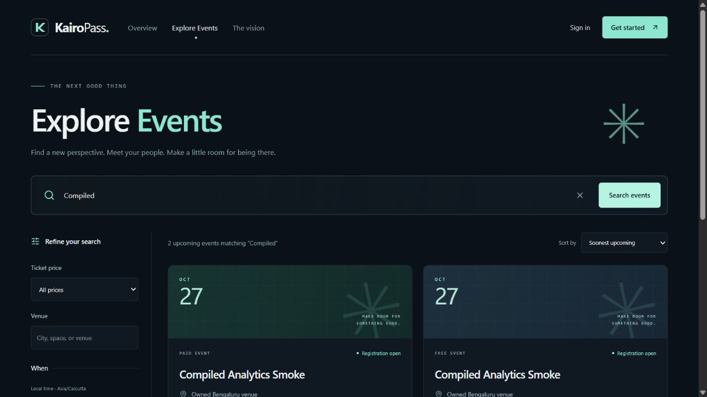
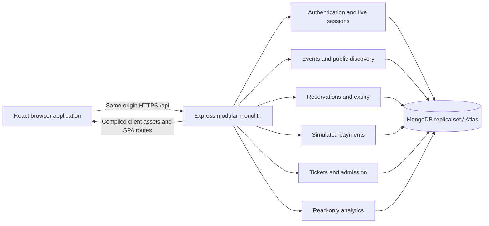

# KairoPass

**Discover an event. Reserve a place. Carry a signed ticket. Enter once.**

KairoPass connects event discovery, ten-minute reservations, simulated checkout,
digital tickets, entrance verification and organizer reporting in one MERN app.

[Source code](https://github.com/KaizokuHam/kairopass) ·
[CI](https://github.com/KaizokuHam/kairopass/actions/workflows/ci.yml) ·
[Deployment guide](docs/deployment.md) · [Demo script](docs/demo.md) ·
[Submission package](docs/submission.md)

**Release status:** Tasks 01–13 are implemented and locally verified. Task 14
deployment preparation is in progress. A public HTTPS URL has not yet been
verified; see the [production verification record](docs/production-verification.md).
Payments are simulated: **no real money is collected**.

## Problem and users

Small event teams often manage discovery, bookings, payment records and entrance
lists in separate tools. KairoPass keeps that journey together with durable
records and explicit recovery when a request is interrupted.

- **Attendees:** explore upcoming events, hold one ticket, complete simulated
  checkout, download an authentic QR ticket and review booking history.
- **Organizers:** publish events, manage capacity, admit eligible tickets once,
  inspect check-in history and report bookings, attendance and simulated revenue.

## Five working workflows

| Workflow | What the application does |
| --- | --- |
| Event management | Owned draft creation/editing, future publication, frozen published schedule/price/capacity, safe cancellation |
| Discovery and booking | Public search, date/price/venue filters, deterministic pagination, transactional one-unit holds for ten minutes |
| Simulated checkout | Persisted failure/success scenarios, UUID idempotency keys, retained retries, atomic confirmation |
| Digital tickets and entry | One backend-signed QR per eligible confirmation, wallet/PNG export, camera or manual entry, atomic single-use admission |
| Organizer analytics | Read-only owned reporting, exact simulated paise totals, cohort conversion, attendance, UTC trends and event comparison |

An elapsed hold releases capacity through transactional expiry. Free tickets
still require explicit zero-value checkout. A signature alone never grants
entry: the server checks ownership, persisted eligibility, time and ticket state.
Check-in opens two hours before an event and closes at its end.

## Product preview



Actual Task 13 browser capture against an owned disposable MongoDB replica set.
The event records in this image were local verification fixtures; the image is
not evidence of a hosted deployment.

## Architecture



One Node process serves both React and `/api` in production. Controllers handle
HTTP boundaries; services enforce business transitions through the single
Mongoose connection. Explicit DTOs isolate persistence from presentation.
Development uses Vite at `http://localhost:5173`, proxying `/api` to
`http://127.0.0.1:4000`.

| Layer | Committed versions |
| --- | --- |
| Runtime | Node 24.14.0 (supported range 24.14+ below 25), npm 11.9.0 |
| Frontend | React 19.3.1, Vite 8.3.5, React Router 8.5.0, Tailwind CSS 4.3.3 |
| Backend | Express 5.3.0, Mongoose 9.11.4, Zod 4.6.7, TypeScript 6.0.3 |
| Security | Argon2id, HS256 JWT cookies, persisted revocable sessions, independent ticket HMAC-SHA256 |
| Verification | Vitest 5.0.5, RTL/user-event, Supertest, real MongoDB 8.2.6 disposable replica sets, GitHub Actions |

### Engineering decisions

- **Capacity correctness:** allocate/release an Event unit and transition its
  Reservation in one transaction; check inventory against HELD + CONFIRMED.
- **Payment recovery:** persist PENDING before finalization; the same key resumes
  the original request. A deliberate retry after failure uses a new key.
- **Ticket authenticity:** backend-generated nonce, canonical signed payload,
  unique reservation/nonce indexes and a signing key independent of JWT.
- **Replay-safe entry:** a conditional ISSUED → USED write with database-clock
  eligibility approves one scanner; replay retains the original admission time.
- **Trustworthy reporting:** snapshot aggregations reduce payment retries before
  joins; integer paise totals travel as strings and render through BigInt.
- **Session safety:** HttpOnly/Secure production cookies, exact configured Origin,
  live persisted roles and ownership; no tokens or identity in browser storage.

See [architecture](docs/architecture.md), [database](docs/database.md) and the
[release-readiness audit](docs/release-readiness.md) for trade-offs and limits.

## Run locally

Prerequisites: Node 24.14+ on the 24.x line, npm 11+, and an owned transactional
MongoDB replica set or Atlas database. A standalone MongoDB server is rejected.

```powershell
npm ci
Copy-Item .env.example .env
# Configure your replica-set URI and two independent signing secrets in .env.
npm run dev
```

On macOS/Linux use `cp .env.example .env`. The [database guide](docs/database.md#local-development)
shows replica-set initialization. Open **http://localhost:5173** so the browser
Origin matches `CLIENT_ORIGIN`. Keep Vite's proxy target at 127.0.0.1:4000.
The shell and liveness work without MongoDB; business workflows need readiness.

Generate each signing key independently, running this command twice:

```sh
node -e "process.stdout.write(require('node:crypto').randomBytes(48).toString('base64url'))"
```

Save values only in the ignored `.env` or hosting secret manager. Never commit
them, share them in screenshots or place them in `VITE_*`.

### Environment reference

| Name | Purpose |
| --- | --- |
| `NODE_ENV` | development locally; production on the host |
| `HOST`, `PORT` | Loopback/4000 locally; 0.0.0.0 and provider PORT when hosted |
| `MONGODB_URI` | TLS Atlas URI or owned local replica-set URI with explicit database |
| `APP_ORIGIN` | Explicit API/browser origin; exact HTTPS public origin in production, no trailing slash |
| `CLIENT_ORIGIN` | localhost:5173 for development; actual public origin when hosted |
| `API_PROXY_TARGET` | Development only, http://127.0.0.1:4000 |
| `JWT_SECRET` | Strong canonical base64url session-signing key |
| `TICKET_HMAC_SECRET` | Independent strong canonical base64url QR-signing key |
| `JWT_EXPIRES_IN`, `JWT_ISSUER`, `JWT_AUDIENCE` | Session lifetime and verification identifiers |
| `LOG_LEVEL` | info or silent |
| `AUTH_LOGIN_MAX_REQUESTS`, `AUTH_REGISTER_MAX_REQUESTS` | Separate per-IP, per-process 15-minute limits; defaults 10 and 5 |

Missing/weak signing configuration fails its protected features with 503.
`/api/ready` verifies database topology, indexes and ping; it does not certify
signing configuration. Initial connection failures require a corrected restart.
Production cookies are always Secure. See [deployment](docs/deployment.md) for
hosted configuration, proxy/limiter limits and recovery.

## Verify and build

```sh
npm run lint
npm run typecheck
npm test
npm run build
npm run check
```

The Task 13 baseline passed **1,062 tests in 42 files**: 394 frontend and 668
backend, zero failures/skips, plus lint, strict types and both builds. The
[Task 14 verification record](docs/production-verification.md) separates current
release checks from that historical evidence.

Database tests start and clean only their own disposable replica sets. They
ignore application `MONGODB_URI`; never point a cleanup fixture at Atlas.
Frontend tests run at the HTTP boundary with real provider/router behavior.
A quiet host is needed for the unchanged startup/assertion deadlines.

| Command | Scope |
| --- | --- |
| `npm run test:unit` | No MongoDB process |
| `npm run test:db` | Complete real database integrations |
| `npm run test:auth`, `test:events`, `test:discovery` | Authentication and event APIs |
| `npm run test:reservations`, `test:payments`, `test:tickets` | Inventory, idempotency, cryptography and issuance |
| `npm run test:checkin`, `test:analytics` | Admission and reporting |
| `npm run test:release` | Connected lifecycle and independent inventory/reporting checks |
| `npm run test:web` | Frontend interactions and HTTP-boundary tests |
| `npm run test:watch -w client` | Frontend watch |
| `npm run test:watch` | Backend watch |

To run the compiled production server: build, supply production environment
settings, then `npm start`. It serves `client/dist` and `server/dist/server.js`;
Vite and tsx are development tools. A local HTTP preview cannot prove HTTPS
Secure-cookie behavior.

## Deployment and evaluation

[render.yaml](render.yaml) prepares one Node web service on Render's Free plan.
It requires real Atlas access, exact assigned HTTPS Origins and separately
generated signing keys. It does not provision a database or embed credentials.
Follow the [deployment runbook](docs/deployment.md), then record actual results
in [production verification](docs/production-verification.md).

Evaluators can self-register each role. Publish a future event with registration
still open, use an attendee account for checkout and generate a ticket. Return
as its organizer to check in during the admission window and inspect analytics.
The [five-minute demo script](docs/demo.md) gives exact preparation and expected
outcomes. [Submission instructions](docs/submission.md) distinguish prepared,
verified, uploaded and submitted.

## Repository map and detailed contracts

```text
client/src/         pages, layouts, scoped hooks, typed services, auth context, UI
server/src/
  modules/         auth, events, discovery, reservations, payments, tickets,
                   checkin, analytics
  models/          User, AuthSession, Event, Reservation, PaymentAttempt, Ticket
  config/          validated environment and one MongoDB lifecycle
  middleware/      readiness/auth/Origin/error/logging/browser-policy boundaries
  app.ts           import-safe Express factory
  server.ts        HTTP, expiry worker and shutdown lifecycle
docs/              contracts, audits, deployment, demo and submission records
.github/workflows/ci.yml
```

Business contracts: [auth](docs/authentication.md), [events](docs/events.md),
[discovery](docs/discovery.md), [reservations](docs/reservations.md),
[payments](docs/payments.md), [tickets](docs/ticketing.md),
[check-in](docs/checkin.md), [analytics](docs/analytics.md).
Historical milestones and test counts are retained in the
[implementation plan](docs/implementation-plan.md); the
[midpoint audit](docs/rubric-audit.md) is historical.

## Known limitations

Payments are deliberately simulated. Public organizer self-registration is an
academic-project policy. Free hosting can sleep and delay background cleanup.
Proxy trust remains false pending a verified provider-specific policy, so users
may share authentication rate-limit buckets behind a proxy. Limiters are
in-memory per process. Local load results do not guarantee hosted capacity.

Static QR exports can be copied; persisted single-use admission prevents a second
approval but does not establish the presenter's identity. Ticket-key rotation
invalidates old exports; no key ring is implemented. Physical-camera compatibility
requires a separate device check; manual full-credential entry is available.
There is no confirmed-booking cancellation, refund, transfer or revocation-creation
workflow. Hosted HTTPS/Atlas acceptance and video/submission status are reported
explicitly in the release documents.

## License

[MIT](LICENSE). Copyright 2026 KaizokuHam.
