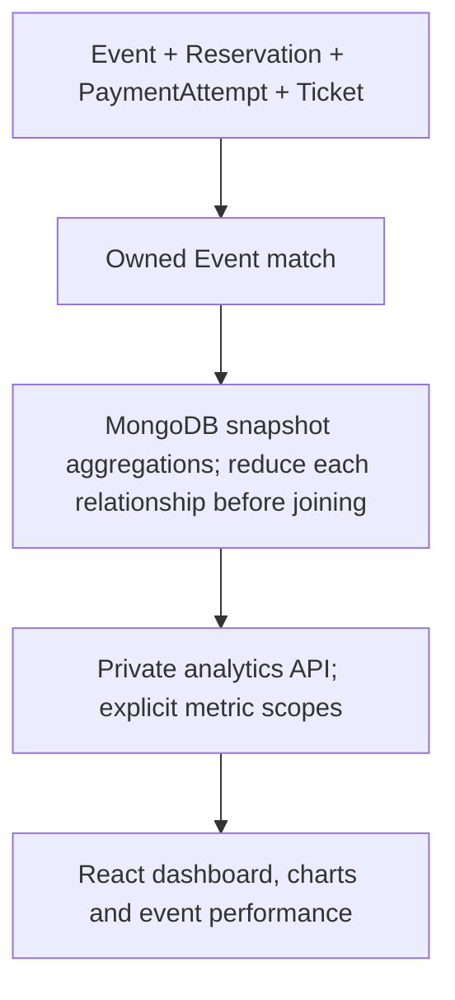

# Organizer analytics — Task 12

The [verification guide](production.md#verification) covers the connected browser
journey and independent unchanged-business-record snapshots around reporting.
Metric definitions and aggregation semantics below are unchanged by that audit.

Analytics is private, read-only reporting over persisted Event, Reservation,
PaymentAttempt and Ticket records. No money is collected and every financial
value is labelled **Simulated Gross Revenue**.

## Central metrics contract

Metrics have separate current/lifetime and selected-period scopes. Current event
counts include owned draft, published, cancelled and past events regardless of
the period. Current inventory uses Event.reservedCount; remaining is capacity minus
that counter. Active holds require HELD and expiresAt strictly after generatedAt.
Elapsed HELD records are reported separately as awaiting expiry; reports do not
run cleanup or release their still-occupied inventory.

Current reservation totals count all retained records by status. Tickets created
means all ever-created records; tickets issued means current ISSUED. Check-ins
require USED and a date checkedInAt. Revoked tickets remain history. Cumulative
attendance is current valid USED / all current CONFIRMED reservations. Inventory
utilization is occupied / capacity. Rates without a denominator, or with an
inconsistent numerator above the denominator, are null/N/A, never clamped.

Selected-period events use Event.createdAt. Reservation creation and conversion
use the same Reservation.createdAt cohort: currently CONFIRMED from that cohort /
all reservations created in it. Conversion can evolve as holds settle. Ticket
creation uses Ticket.createdAt; check-in activity uses Ticket.checkedInAt.

Successful simulated payments and simulated gross revenue use completedAt and
require exactly one SUCCESS for a CONFIRMED reservation, matching safe integer
paise amount, original SUCCESS simulation outcome and a real completion date.
Multiple SUCCESS records, invalid amounts or missing durable evidence exclude
that reservation's success/revenue and increment invalidSuccessReservations.
There is no arbitrary winner or data repair. Failed and pending attempt activity
uses PaymentAttempt.createdAt and current status. Retries count as attempts, not
bookings or additional revenue. Free confirmations count as successful bookings
and payments with zero paise. Invalid ticket lifecycle data is counted separately.
Integrity diagnostics cover all current records in the owned scope, independently
of the selected activity interval.

Paise is converted from a validated safe integer through MongoDB Int64 to Decimal128
before summing, avoiding floating-point totals. Monetary totals are canonical
nonnegative integer **strings** in JSON; the browser formats them with BigInt and
Indian digit grouping. Counts remain safe integers; numeric overflow fails closed.

## Reporting interval

Use period=7d, 30d (default), 90d or all; custom from/to must both be ISO instants
with timezone offsets and span at most 366 days. Bounds are [from,to). Presets
start at UTC midnight N−1 days ago and end at generatedAt. All-time begins at UTC
midnight of the oldest owned event creation. Application-created child records
cannot predate their event. No-event all-time uses a zero-filled 30-day window.

Trends use UTC buckets starting at from, with width ceil(range days / 90) days
(minimum one). At most 90 points are returned; final bucket can be partial. Empty
buckets contain zeros. Confirmed trend means current confirmed members of each
reservation-creation cohort, not the unrecorded time of confirmation.

## Data flow

## HTTP contracts and security

| Method/path | Response data |
| --- | --- |
| GET `/api/organizer/analytics/overview` | scope, metrics, trends, events, pagination |
| GET `/api/organizer/analytics/trends` | scope, trends |
| GET `/api/organizer/analytics/events` | scope, events, pagination |
| GET `/api/organizer/events/:eventId/analytics` | Complete report scoped to one owned event |

All use `{ success: true, data: ... }`. Common query parameters are period or
paired from/to, optional eventId, page (1–10000), limit (1–50; default 10), and
sort (date_asc, date_desc, bookings, revenue, checkins). Date sort uses startAt;
metric sorts are descending current confirmed count, selected-period simulated
gross revenue or cumulative USED count. ObjectId is the stable tie-breaker. A path
event ID cannot be combined with a query eventId. Unknown/repeated/operator keys,
malformed dates, invalid enums and excessive bounds return 400
INVALID_ANALYTICS_QUERY. Missing/unowned path or filter events return 404.

The dashboard requests the combined overview once per filter/page change. That
single snapshot supplies its KPIs, three charts and paginated table, avoiding three
copies of the same expensive aggregation. Narrow endpoints are available to
separate consumers; the events endpoint omits series work. A single-event report
uses the same aggregate definitions, not a divergent implementation.

`scope` returns from, to, generatedAt, timezone UTC and bucketDays. Metrics contain:

- `current`: totalEvents, publishedEvents, draftEvents, cancelledEvents, capacity,
  occupiedCapacity, remainingCapacity, capacityUtilization, totalReservations,
  activeHolds, elapsedHolds, confirmedBookings, expiredHolds, cancelledHolds,
  ticketsCreated, ticketsIssued, ticketsUsed, ticketsRevoked and attendanceRate.
- `period`: eventsCreated, reservationsCreated, cohortConfirmed,
  reservationConversionRate, successfulSimulatedPayments,
  failedSimulatedPaymentAttempts, pendingSimulatedAttempts, ticketsCreated,
  checkIns and simulatedGrossRevenuePaise.
- `integrity`: invalidSuccessReservations and invalidTicketRecords.

Each event row has id, title, status, startAt and the same three metric objects.
Pagination has page, limit, total and totalPages. Trend points have from/to,
reservationsCreated, cohortConfirmed, successfulSimulatedPayments, checkIns and
simulatedGrossRevenuePaise. No user/attendee identifiers, emails, payment request
keys, transaction IDs, QR credentials, nonces, secret fields or raw model objects
are exposed. The frontend validates the DTO, rates, page shape and exact agreement
between series sums and period totals before displaying results.

Every endpoint requires readiness, a live AuthSession/JWT and the current persisted
ORGANIZER role. The organizer ID comes only from verified authentication, never
the client. The first aggregation stage matches owned events, before any related
record is joined. Owning organizers retain access to draft, cancelled and past
events independently of public discovery. Responses are no-store. GETs perform
no mutation, cleanup, reconciliation, export or credential verification. Invalid
ticket signing configuration does not disable analytics; invalid JWT configuration
or unavailable MongoDB does. Failures give safe 503 ANALYTICS_UNAVAILABLE or
ANALYTICS_STATE_UNAVAILABLE, without fabricated zeros or database diagnostics.

## Aggregation and precision

One bounded metadata read finds the oldest scoped event for all-time bounds and
validates a requested event's ownership. The main pipeline starts at indexed owned
Events. Adjacent indexed equality lookups/unwinds stream Reservations and
PaymentAttempts instead of starting a nested subpipeline for every booking.
All payment rows reduce to one row per reservation before its unique Ticket is
joined. Lifetime success uniqueness is checked even when duplicates lie in
different periods. A failed retry cannot multiply booking or ticket counts. A
composite event/reservation grouping key also retains each event without bookings.
Each booking contributes at most three activity points: creation, one genuine
successful settlement and check-in. A final facet groups overall metrics, a sorted
event page/count and chronological series. Node only maps bounded output and
fills at most 90 zero buckets; it does not load entire collections or owned IDs.
The ticket equality lookup is bounded to one record by its existing unique index.
See [MongoDB lookup/unwind optimization](https://www.mongodb.com/docs/v8.0/core/aggregation-pipeline-optimization/).

The main aggregate uses a five-second budget, no disk spill and MongoDB snapshot
read concern. It reads a consistent committed point across the joined collections
without starting a write transaction. The metadata read is separate; published
ownership is immutable and event creation dates are fixed in normal workflows.
Different HTTP reports are independent snapshots, not a frozen historical ledger.
See [MongoDB snapshot reads](https://www.mongodb.com/docs/manual/reference/read-concern-snapshot/).

Existing event_organizer, reservation event-prefix, payment reservation-prefix
and unique ticket reservation indexes cover the relationship access paths. Actual
index metadata is verified during startup and integration tests. No new index,
materialized collection, scheduled aggregation, database or connection was needed.
There are no per-event application query loops. Metric sorting still aggregates all
matched owned events before selecting a page; query budgets intentionally fail
with an error if a report is too expensive. Larger tenants may need measured
compound indexes, cursor pagination or a deliberate reporting design later.

Source amounts must be nonnegative safe integers. Conversion to Int64 before
Decimal128 preserves the full exact integer; aggregate totals never pass through
floating-point rupees. Decimal output must remain a canonical integer of at most
34 digits. Count overflow, invalid money totals and impossible occupied capacity
fail closed. Missing aggregate envelopes also fail closed: a valid empty facet
envelope is distinct from an absent result. The shared price formatter accepts
validated paise strings and formats BigInt rupees/cents without precision loss.
See [MongoDB decimal conversion](https://www.mongodb.com/docs/manual/reference/operator/aggregation/todecimal/).

## Dashboard

Protected routes are `/organizer/analytics` and
`/organizer/events/:id/analytics`. Organizer dashboard/sidebar and every event
detail link to real reports, including historical events. Six KPI cards explicitly
name their scope and denominator. Supporting breakdowns show event states,
inventory, elapsed holds, payment outcomes and ticket lifecycle totals. Integrity
diagnostics are visible; reports never silently repair records.

Period, sort, page and event filters use URL parameters. Event selection is bounded
to the current table page; any owned event can also be opened through its private
event report. Custom inputs name the browser timezone and convert local components
to UTC instants, preserving [from,to). Changing filters resets pagination. Charts
label UTC grouping separately from locally formatted report/event times.

Three dependency-free SVG charts display actual reservation cohorts, simulated
gross revenue and check-ins. They have labelled units/dates, hover values,
keyboard-accessible bucket sliders, textual selected-bucket values and complete
data tables. Empty datasets display honest no-activity messages, not growth curves.
No comparative arrows, forecasts or invented recommendations are shown. The event
performance table has stable server sorting/pagination and a focusable horizontal
scroll region on small screens; the document itself remains within the viewport.

The page is lazy-loaded. It reuses the existing API/AuthProvider and owner-scoped
abort/generation hook. Loading clears obsolete values; failures show retry without
substituting zeros. Refresh reads persisted state. Account/session changes and
logout hide old private reports immediately. No analytics data or credentials are
stored in browser storage, and no automatic POST exists.
Aborting a browser read hides obsolete results; an already-started server aggregate
can still finish within its query budget.

## Verification and limits

`npm run test:analytics` runs numeric-integrity policy tests and real HTTP/MongoDB
aggregations on an owned disposable replica set. Normal tests and CI include both;
test:db explicitly includes the integrations. The independently calculated fixture
contains two organizers, paid/free events, failed retries, pending/elapsed/expired/
cancelled holds, unissued confirmed bookings and ISSUED/USED/REVOKED tickets.
It verifies exact totals, cohort consistency, inclusive/exclusive timezone bounds,
zero buckets, duplicate-success diagnostics, large integer totals, stable sorting/
pagination, safe outages and complete business-record immutability.

A separate real HTTP journey registers users, publishes events, repeats failure
and success idempotency keys, issues/admit a paid ticket and confirms a free hold.
Frontend tests keep the real provider/router/HTTP boundary and cover current/period
labels, charts/tables, exact formatting, custom filters, pagination, drill-down,
stale aborts, outages, logout and account isolation. Browser acceptance exercises
the actual same journey and independently inspects persisted records. Final
counts, compiled-server checks and local performance observations are recorded in
the [verification guide](production.md#verification).

These are current-state reports, not historical status snapshots. Conversion can
change after a hold settles. Inventory may include elapsed HELD records until the
existing worker releases them; analytics deliberately never writes. Corrupt or
legacy success evidence is excluded and diagnosed, not estimated. Ticket lifecycle
counts do not independently prove authenticity of arbitrary out-of-band records.
Orphan records without an owned event/reservation relationship are outside the
report scope. No refunds, tax, net revenue, payouts, forecasts, exports, real
payments, warehouse or cross-organizer administrative reporting are included.
Local measurements do not establish hosted production capacity. Task 13 hardening
and Task 14 deployment remain separate work.
