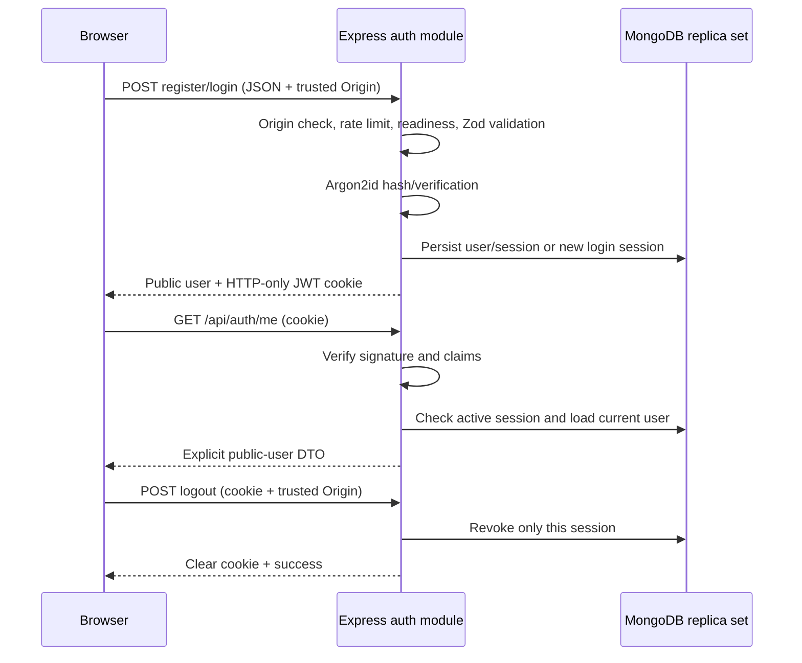

# Authentication backend

Task 03 implements database-backed cookie authentication. The React authentication
pages and protected frontend routes belong to Task 04 and are not implemented here.

## Architecture and flow

`modules/auth` separates routes, controllers, services, Zod validation, password
utilities, token/cookie utilities, and request context types. Existing Mongoose
connection/readiness middleware is reused; no second database client is created.



Registration performs a precheck and also catches the real unique-email index
failure if another registration races. User/session insertion is transactional:
a session-persistence failure rolls back the new user. A network failure after a
successful commit can still interrupt HTTP delivery; the user can subsequently
log in. Login creates a fresh independent session. Sessions are not refreshed
automatically; users log in again after expiry.

## API

Responses produced by the auth router have `Cache-Control: no-store`, including
its authentication/validation errors. Malformed JSON is rejected earlier by the
existing global parser and uses the existing global error contract.
POST bodies for registration/login must use `Content-Type: application/json`.
Every POST below requires an exact trusted `Origin`, including curl/API clients.
Browsers set Origin automatically; frontend JavaScript should use relative `/api`
URLs and must not attempt to set or read the session cookie itself.

### POST `/api/auth/register`

```json
{
  "name": "Test Attendee",
  "email": "attendee@example.com",
  "password": "Example-only StrongPassword123!",
  "role": "ATTENDEE"
}
```

HTTP **201**, with the authentication cookie and this safe response shape:

```json
{
  "success": true,
  "data": {
    "user": {
      "id": "507f1f77bcf86cd799439011",
      "name": "Test Attendee",
      "email": "attendee@example.com",
      "role": "ATTENDEE",
      "createdAt": "2026-10-26T04:00:00.000Z",
      "updatedAt": "2026-10-26T04:00:00.000Z"
    }
  }
}
```

ATTENDEE (default when omitted) and ORGANIZER are both public registration roles
for this academic application. There is no ADMIN role. Unknown fields, including
`isAdmin`, `passwordHash`, `_id`, and arbitrary database operators, are rejected.
The controller never forwards an entire request body to Mongoose.

Validation:

- Name: trimmed, 2–100 UTF-16 code units.
- Email: trimmed, lowercase, valid email syntax, at most 254 code units.
- Password: at least 8 Unicode code points, at most 128 UTF-16 code units and 256
  UTF-8 bytes. Passwords are **not trimmed** and have no forced composition rule.
- Role: only ATTENDEE or ORGANIZER.

Duplicate normalized emails return **409 `EMAIL_IN_USE`**, including index races.
This endpoint intentionally reveals account existence through that documented
conflict response; login uses a generic failure instead.

### POST `/api/auth/login`

```json
{ "email": "attendee@example.com", "password": "Example-only StrongPassword123!" }
```

HTTP **200** with the same public-user response shape and a new session cookie.
Login normalizes email, explicitly selects `+passwordHash`, and verifies it with
Argon2id. Wrong passwords and unknown accounts both return **401
`INVALID_CREDENTIALS`**, message `Invalid email or password.` No JWT is returned
in JSON. Unknown accounts perform verification against a process-cached dummy
Argon2id hash to avoid a cheap nonexistent-account failure. This reduces obvious
computational timing differences; it is not a claim of perfectly constant total
network/database timing. Invalid stored hashes fail securely with dummy verification.

### GET `/api/auth/me`

HTTP **200** with `{ "success": true, "data": { "user": ... } }` when authenticated.
Missing, malformed, tampered, expired, revoked, or unbacked sessions and deleted
users return **401 `UNAUTHENTICATED`**. Invalid sessions never return null with 200.
This endpoint restores browser auth state in Task 04. Bearer headers, query
parameters, localStorage, and sessionStorage are not token transports.

### POST `/api/auth/logout`

No body is required. HTTP **200**:

```json
{ "success": true, "message": "Logged out successfully." }
```

The service verifies the cookie and conditionally marks that session's
`revokedAt`, then the controller clears the cookie. A copied token can no longer
authenticate subsequent requests. Other sessions for the same user remain active.
Missing/invalid/expired/already-revoked cookies produce the same success response
and cookie clearing while MongoDB is available. If MongoDB is unavailable, return
503 rather than pretend that a valid session was revoked. Revocation does not
cancel requests that already passed authentication before logout completed.

### Example local requests

Use a test password, never a real password in command history. The cookie jar
contains credentials and must remain outside tracked source (the example uses
the ignored `artifacts/` directory). In PowerShell use `curl.exe`; on POSIX use `curl`.

```sh
curl -i -c artifacts/auth.cookies \
  -H 'Origin: http://localhost:5173' -H 'Content-Type: application/json' \
  --data '{"name":"Test Attendee","email":"attendee@example.com","password":"Example-only StrongPassword123!","role":"ATTENDEE"}' \
  http://127.0.0.1:4000/api/auth/register
curl -i -b artifacts/auth.cookies http://127.0.0.1:4000/api/auth/me
curl -i -b artifacts/auth.cookies -c artifacts/auth.cookies \
  -H 'Origin: http://localhost:5173' -X POST http://127.0.0.1:4000/api/auth/logout
```

Create `artifacts/` first if needed. Shell line-continuation syntax varies; the
examples above use POSIX syntax. Prefer the Vite proxy for browser development.

## Password protection

`argon2` hashes with **Argon2id, 19 MiB memory, 2 iterations, parallelism 1, a
32-byte hash**, and independent salts. This follows the minimum configuration in
the [OWASP password storage guidance](https://cheatsheetseries.owasp.org/cheatsheets/Password_Storage_Cheat_Sheet.html).
Mongoose defaults omit password hashes, serialization strips them even after
explicit selection, and API responses use the existing `toPublicUser` allowlist.
No plaintext password, credential-bearing body, cookie, JWT, or signing secret is
logged. Auth-specific unexpected errors are sanitized before reaching the central
error handler.

## JWT claims and cookie configuration

Tokens use **HS256**, with only `sub`, `jti`, `iat`, `exp`, `iss`, and `aud`.
Verification pins the algorithm and token type, validates issuer/audience,
requires every claim, checks expiration/issued time, validates subject/JTI shape,
and refuses a token lifetime longer than configured. Tokens contain no roles,
email, password, password hash, or signing secret. JWTs are signed, not encrypted.

`jti` is a backend-generated 256-bit random identifier. Only its SHA-256 hash is
stored in MongoDB, never the raw identifier or the complete JWT. The token expires
at the same configured deadline as its session record; default lifetime is 12
hours. Verification also checks session expiry/revocation on every request.

Cookie **`kairopass_session`**:

| Option | Behavior |
| --- | --- |
| HttpOnly | Always true |
| Secure | Always true in production; false only for local development/test HTTP |
| SameSite | Lax |
| Path | `/` |
| Domain | Omitted (host-only) |
| Max-Age | Remaining time until JWT/session expiry |

Clearing uses the same HttpOnly/Secure/SameSite/Path options. Secure behavior is
derived from `NODE_ENV`; a legacy `COOKIE_SECURE=false` cannot turn it off.
Ambiguous duplicate authentication cookies are rejected. HttpOnly prevents normal
JavaScript cookie reads; it does not prevent XSS from acting through a user's browser.

## AuthSession persistence

`models/AuthSession.model.ts` adds authentication infrastructure alongside the
five unchanged business models:

| Field | Rule |
| --- | --- |
| `_id` | Generated ObjectId |
| `userId` | Required immutable ObjectId ref User |
| `jtiHash` | Required immutable 64-character SHA-256 hex digest, unique |
| `expiresAt` | Required immutable Date |
| `revokedAt` | Date or null, default null |
| `createdAt`, `updatedAt` | Automatic timestamps |

Indexes: unique `jtiHash`, `userId` association lookup, and `expiresAt` TTL with
`expireAfterSeconds: 0`. Existing additive index initialization verifies these
actual database indexes, including the TTL option. TTL deletion is asynchronous;
authentication checks expiry itself and never waits for cleanup. TTL applies only
to sessions, never to users, reservations, payments, or tickets.

## Authentication and authorization middleware

`requireAuth(config)` verifies the cookie, checks the active database session,
loads the current user, rejects missing/deleted/unsupported-role users, and
attaches a typed safe `req.auth` containing the public user and session record ID.
It does not trust a stale role embedded in a token. `requireRole(...roles)` returns
401 without authentication and 403 if the current persisted role is not permitted.

Example for later modules (no event routes are added in Task 03):

```typescript
router.get('/organizer-resource',
  requireDatabase,
  requireAuth(authConfig),
  requireRole('ORGANIZER'),
  handler
);
```

Role authorization does **not** establish event/resource ownership. Later services
must explicitly compare the authenticated user's ID to the resource owner.
Future cookie-authenticated mutation routers must also attach the Origin defense.

## CSRF, CORS, and rate limits

All unsafe auth requests require an exact allowlisted `Origin`, including login
and registration to prevent login CSRF. Missing, opaque (`null`), and untrusted
origins return **403 `UNTRUSTED_ORIGIN`** before credential work. Production allows
only the explicit HTTPS `APP_ORIGIN`. Development/test allow `APP_ORIGIN` and the
configured `CLIENT_ORIGIN`. Host, X-Forwarded-Host, and other client-controlled
forwarding headers never define trusted origins. JSON-only registration/login
also prevents ordinary cross-site HTML form submissions.

Development CORS permits the configured frontend origin with credentials, without
a wildcard. Production keeps the existing same-origin approach and does not enable
cross-origin credentialed CORS. Use relative `/api` requests through Vite. If you
open Vite as `http://127.0.0.1:5173` instead of `http://localhost:5173`, set
`CLIENT_ORIGIN` to that exact origin and restart; aliases are not silently trusted.

Origin defense assumes modern browsers supply an honest Origin on unsafe requests.
Command-line clients must send it explicitly and can forge it; Origin is a CSRF
defense, not a replacement for credentials or authorization. SameSite alone cannot
protect against every same-site/sibling-origin attack. See
[OWASP CSRF guidance](https://cheatsheetseries.owasp.org/cheatsheets/Cross-Site_Request_Forgery_Prevention_Cheat_Sheet.html).

Registration and login have independent **15-minute per-IP** in-memory limits,
default **5 registrations** and **10 login requests**. All attempts, including
successful and validation-failing ones, count once they pass the Origin check.
429 responses use the normal JSON error format with Retry-After and standard
RateLimit headers. The library handles IPv6 address grouping.

Express `trust proxy` is deliberately **false**. Forwarded IP headers cannot bypass
limits. A reverse proxy therefore shares its socket IP's quota across clients;
deployment must establish a trusted proxy/address policy before enabling forwarded
IP handling, rather than blindly trusting arbitrary headers. In-memory limits
reset on restart and are not shared across processes/replicas; distributed
deployments require a shared rate-limit store. Limits do not replace edge-level
DoS protection or stronger future account security policies.

## Configuration and startup

| Variable | Requirement/default |
| --- | --- |
| `MONGODB_URI` | Existing replica-set/Atlas application database |
| `JWT_SECRET` | At least 32 cryptographically random bytes, encoded as unpadded base64url |
| `JWT_EXPIRES_IN` | `12h`; s/m/h/d values, minimum 60 seconds and maximum 7 days |
| `JWT_ISSUER` | `kairopass-api` |
| `JWT_AUDIENCE` | `kairopass-web` |
| `APP_ORIGIN` | Development default `http://127.0.0.1:4000`; explicit HTTPS origin required in production |
| `CLIENT_ORIGIN` | Existing development frontend origin, default `http://localhost:5173` |
| `AUTH_LOGIN_MAX_REQUESTS` | 10; positive integer up to 1000 |
| `AUTH_REGISTER_MAX_REQUESTS` | 5; positive integer up to 1000 |
| `NODE_ENV` | Controls production cookie/origin enforcement |

Generate locally, then place the output only in the ignored root `.env` or a
production secret store:

```sh
node -e "process.stdout.write(require('node:crypto').randomBytes(48).toString('base64url'))"
```

Configuration rejects missing/short/repeated/known-placeholder secrets, malformed
encoding, invalid lifetimes, and missing/non-HTTPS production origins. Validation
cannot prove randomness: use the generator rather than a human-chosen string.
Never prefix secrets with `VITE_`. `COOKIE_SECRET` is unnecessary for an already
signed JWT; cookie Secure cannot be configured off in production.

Invalid auth configuration produces a fixed startup error and all four endpoints
return **503 `AUTH_UNAVAILABLE`** without a signing fallback. `/api/health` and
frontend delivery remain available. `/api/ready` retains its **database-only**
meaning; it does not assert that JWT configuration is valid. Correct configuration
and restart the server. All enabled auth endpoints use `requireDatabase`; unavailable
MongoDB produces a safe 503. Deployment requires HTTPS at the public origin,
protected secrets, a working replica set/Atlas URI, and a deliberate proxy policy.

## Error contract

```json
{
  "success": false,
  "error": {
    "code": "UNAUTHENTICATED",
    "message": "Authentication is required.",
    "requestId": "generated-request-id"
  }
}
```

| HTTP | Code / use |
| --- | --- |
| 400 | VALIDATION_ERROR, with field/message details and no submitted values; INVALID_JSON for malformed JSON |
| 401 | INVALID_CREDENTIALS or UNAUTHENTICATED |
| 403 | FORBIDDEN or UNTRUSTED_ORIGIN |
| 409 | EMAIL_IN_USE |
| 429 | RATE_LIMITED |
| 503 | AUTH_UNAVAILABLE or DATABASE_UNAVAILABLE |
| 500 | Unexpected authentication failure, sanitized as INTERNAL_ERROR |

## Verification and remaining scope

`npm run test:auth` runs token/config/password unit tests and real HTTP auth
integration tests. `npm run test:unit` excludes all `*.integration.test.ts` files;
`npm run test:db` includes model and auth integration suites. `npm run check` runs
all tests, lint, strict types, and both builds. Tests generate ephemeral signing
keys and own a disposable MongoDB replica set; they never use application/Atlas
credentials for test data or cleanup. Targeted fault injection tests exercise
transaction rollback and mid-request connection errors alongside real database
index, transaction, and session checks.

No refresh tokens, password reset, email verification, MFA, frontend auth forms,
event endpoints, reservations, payments, QR signing, or check-in workflows are
implemented by Task 03. Password/secret rotation and all-session revocation UI
are also outside this task. A signing-key change invalidates existing JWTs.
