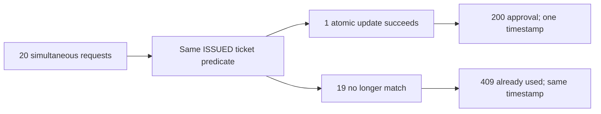

# Organizer admission — Task 11

The [verification guide](production.md#verification) covers real manual
admission/replay, USED wallet refresh and all five responsive widths. It corrects
the preview's aspect-ratio/min-height overflow at 320 px with an explicit bounded
width. This layout correction does not change camera permissions or admission policy.

An authenticated organizer can check a signed ticket into an event they own at
`/organizer/events/:id/check-in`. The server and persisted Ticket state decide
admission. Camera decoding and a valid signature alone never approve entry.
No new collection, connection, environment variable or worker is introduced.
Task 12 analytics remains outside this milestone.

## Admission policy

Check-in opens **two hours before startAt, inclusive**, and closes **at endAt,
exclusive**. PUBLISHED events can admit before and after their start. Registration
deadlines control booking, not admission. Draft, cancelled, too-early and ended
events cannot admit. UTC instants are compared on the server; the UI formats the
window in the operator's timezone. Invalid persisted dates fail closed with 503.

Every request requires database readiness, a live database-backed JWT session,
the current persisted ORGANIZER role, and Event ownership. POST also requires the
exact trusted Origin and valid independent ticket signing configuration. Responses
use `Cache-Control: no-store`. POST is limited to 180 requests/minute per verified
organizer per process; multiple instances need a deliberate shared limiter policy.

The service reuses Task 10's canonical v1 `verifyTicket`: at most 512 characters,
minimal ID/nonce data, domain-separated HMAC-SHA256 and length-checked
`timingSafeEqual`. It compares the real persisted nonce in constant time, checks
the ticket's reservation/event association, ticket state, admission window,
CONFIRMED reservation, exactly one matching durable SUCCESS payment (including
free checkout), and an existing attendee account. Unknown, wrong-event, orphaned
and stale-nonce tickets share `INVALID_TICKET`, without leaking another attendee.

```mermaid
sequenceDiagram
  participant O as Organizer workspace
  participant D as Local decoder
  participant API as Check-in service
  participant DB as MongoDB
  O->>D: Explicit Start camera
  D-->>O: One credential; stop stream
  Note over O: Manual paste uses the same API
  O->>API: POST owned event/check-ins
  API->>DB: Session, ownership, nonce, booking/payment checks
  API->>DB: Conditional ISSUED to USED with database clock
  alt This request wins
    DB-->>API: USED and checkedInAt
    API-->>O: 200 Entry Approved
  else Already consumed
    API-->>O: 409 Already Used; original time
  else Outcome cannot be confirmed
    API-->>O: 503; do not assume approval
  end
```

## API and errors

| Method/path | Request | Response |
| --- | --- | --- |
| POST `/api/organizer/events/:eventId/check-ins` | Strict JSON `{ "qrPayload": "<complete signed credential>" }` | 200 only for a newly recorded admission |
| GET `/api/organizer/events/:eventId/check-ins` | Optional page (1–10000), limit (1–50; default 10) | Owned event/window, persisted USED entries, pagination |

POST returns `{ success: true, data: { checkIn, serverNow } }`. A checkIn contains
only ticketId, eventId, status USED, checkedInAt (ISO), attendeeName and eventTitle.
No QR, nonce, payment details, attendee email or secret is returned. An already-used
record never produces an approval response.

GET returns `{ success: true, data: { event, window, checkIns, pagination,
serverNow } }`. Event fields are id, title, venue, status, startAt and endAt;
window fields are opensAt, closesAt and state. Entries use the checkIn shape above.
Pagination includes page, limit, total and totalPages. Sort is checkedInAt DESC,
ticketId DESC. An indexed event/reservation match joins the unique ticket, filters
USED with a real timestamp, facets count/page, and joins only names after limiting
the page. Queries use a two-second limit and majority read concern. Larger
histories may need a measured cursor/index design; no unbounded attendee payload
or analytics dataset is returned.

| Result | Meaning |
| --- | --- |
| 400 INVALID_QR_PAYLOAD / INVALID_CHECKIN_INPUT | Malformed/tampered credential or invalid request; deny |
| 401 / 403 | Session, role or trusted Origin failure |
| 404 EVENT_NOT_FOUND / INVALID_TICKET | Resource unavailable to this organizer; deny |
| 409 TICKET_ALREADY_USED | Deny; safe checkedInAt detail holds the original admission time |
| 409 TICKET_REVOKED | Deny; creating revocations remains a future workflow |
| 409 window/event/reservation/payment errors | Current eligibility fails; deny |
| 409 CHECKIN_CONFLICT | Write did not approve admission; refresh and explicitly retry |
| 429 RATE_LIMITED | Verification paused; observe Retry-After |
| 503 CHECKIN_CONFIGURATION_UNAVAILABLE | Signing configuration invalid; cannot admit |
| 503 CHECKIN_STATE_UNAVAILABLE | Persisted state/schedule cannot be verified |
| 503 CHECKIN_OUTCOME_UNKNOWN | Write might have committed; do not infer approval or definitive rejection |
| 503 CHECKIN_HISTORY_UNAVAILABLE | Read failed; retry history, never show a fake empty result |

Transport loss, 5xx and malformed success responses display Admission Not
Confirmed. There are no automatic POST retries. The operator may refresh history
or explicitly retry the same in-memory credential; a committed first request then
returns Already Used with its original time. The UI only parses previous-admission
details for 409 TICKET_ALREADY_USED with a strict ISO timestamp, and never displays
arbitrary server error content. Auth failures reuse session recovery; a service
outage does not sign the organizer out. History works with invalid ticket signing
configuration, but still requires working auth and MongoDB.

## Atomic consumption and retained history

After eligibility checks, one `Ticket.findOneAndUpdate` matches the exact ticket,
reservation and nonce with status ISSUED and an explicitly existing null
checkedInAt. Its `$expr` checks MongoDB `$$NOW >= opensAt && $$NOW < closesAt` at
the actual write. It sets USED, uses `$currentDate` for checkedInAt/updatedAt,
increments the version, returns the updated record and requests majority
acknowledgement with bounded query/write time. No read-then-unconditional-save exists.

```mermaid
stateDiagram-v2
  [*] --> ISSUED: Verified Task 10 issuance
  ISSUED --> USED: One eligible conditional database write
  ISSUED --> REVOKED: Future authorized revocation
  USED --> USED: Replay denied; timestamp unchanged
  REVOKED --> REVOKED: Admission denied
```



MongoDB serializes competing updates to this document. Only the winner returns
200. Losers read the same-identity record and return 409 with the original time.
Separate scanners, process restarts and reconnects cannot reset this persisted
state. Ticket/history deletion and Ticket TTL remain forbidden.



A multi-document transaction is unnecessary under the current domain contracts:
publication freezes owner/schedule; CONFIRMED reservations and SUCCESS payments
are terminal; cancellation cannot pass an active CONFIRMED reservation. The service
consumes only the Ticket and avoids a hot Event write. Reservation/payment records,
amounts, expiry, ticket identity/nonce and event reservedCount stay unchanged.
Independent tickets can both admit.

Future refund, confirmed-booking cancellation, transfer, ownership/schedule or
mutable payment workflows **must coordinate with ticket consumption**, for example
through appropriate transactional version predicates. Do not add these mutations
while assuming the current reads serialize with them. Arbitrary out-of-band
database edits are not supported eligibility transitions; this service does not
claim serialization against such writes.

## Scanner, history and wallet

Published event details and event-specific organizer navigation link to the
protected workspace. It shows event, venue, opening/closing times, camera/manual
controls, a large textual result and paginated persisted history. Server-time
snapshots and boundary refreshes control availability; the backend stays final.

The camera adapter lazily loads pinned `@zxing/browser` 0.2.1 after explicit Start.
It requests video only, prefers the rear camera and offers available cameras after
permission. Frames decode locally without uploads/storage. Detection stops tracks
before submission; synchronous locks suppress repeated frames/rapid clicks. Scan
Next clears the result, and Start explicitly resumes the camera. Manual paste
sends the complete credential through the identical API and clears the textarea.

Tracks, decoder controls, preview and pending initialization are released on stop,
detection, event navigation, unmount, logout or unavailable session. Late permission
or decoder results cannot restart an obsolete scanner. Credential memory clears on
completion/next/unmount; only uncertainty retains it for explicit same-credential
retry. No credential browser storage, URLs or logging is used. Permission denial,
missing hardware/APIs and insecure contexts leave manual entry usable.

Results use text, icons, focus management and green/red/amber styles. Approval
includes the real attendee, event, ticket and database timestamp. History refreshes
after responses and offers explicit retry on read failure. Fresh attendee
wallet/detail reads show Already Used and checkedInAt; active QR and PNG export
disappear. No push synchronization, polling or offline approval is implemented.

## Verification and operation

`npm run test:checkin` runs 12 policy cases and 66 real HTTP/MongoDB cases. Standard
tests and CI include these suites. Frontend adds 41 cases, covering provider/router,
HTTP boundaries, camera lifecycle and real PNG decoding. See the
[verification guide](production.md#verification) for observed
races, browser proof, the full gate and compiled-server checks.

Production needs HTTPS, a camera-capable browser/device with user permission,
online API access, synchronized application/database clocks, a replica set and the
same independent HMAC key on every instance. Key rotation invalidates old QR
exports; there is no key ring or offline cache. Manual browser admission and real
PNG decoding were exercised; **physical-camera capture has not been verified on
hardware**. Optical focus, lighting and device-specific behavior need deployment
acceptance. Revocation UI, refunds, transfers and analytics are outside Task 11.
