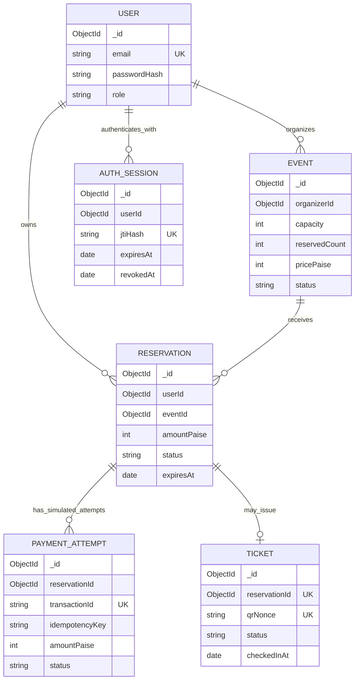

# MongoDB data architecture

KairoPass uses **MongoDB + Mongoose** as its permanent persistence layer. Task 02
implements connection/readiness infrastructure, five models, indexes, and tests.
Task 03 adds AuthSession and database-backed authentication. Task 05 adds private
organizer event management and safe lifecycle operations. Booking orchestration,
simulated checkout, QR signing, and check-in remain later tasks.

## Document relationships



These edges describe application relationships, **not database foreign keys**.
Every `_id` and reference is a MongoDB ObjectId. Mongoose casts/validates reference
shape; it does not check referenced-document existence or roles. The integration
suite deliberately demonstrates that an orphan reference can be persisted.
Future services must check existence, attendee/organizer role, ownership, event
eligibility, and transaction consistency before creating dependent documents.

## Schema structure and types

Models live in `server/src/models/*.model.ts`, with named exports from `index.ts`.
Each exports a raw `*Record` interface and a `HydratedDocument` type. All five use
timestamps (`createdAt`, `updatedAt`), strict unknown-field rejection, disabled
query buffering, and optimistic concurrency for document `save()` operations.
Database types are not public response contracts. `types/public-user.ts` provides
an explicit public-user DTO/allowlist; later endpoints must define their own public
DTOs and Zod input schemas instead of accepting raw model documents as input.

### User (`users`)

| Field | Rules |
| --- | --- |
| `_id` | Generated ObjectId |
| `name` | Required, trimmed, nonempty string |
| `email` | Required, trimmed, lowercase, basic email syntax; unique normalized value |
| `passwordHash` | Required string; omitted by default queries and JSON/object serialization |
| `role` | ATTENDEE (default) or ORGANIZER |
| `createdAt`, `updatedAt` | Automatic Date timestamps |

Authentication services hash passwords with Argon2id and explicitly select
`+passwordHash` only for credential verification. Even an explicitly selected hash
is removed by document serialization. A lean result with an explicit credential
projection bypasses document transforms: never send credential queries directly
to clients; always construct a public DTO. Email normalization must also occur at
HTTP boundaries; raw collection writes can bypass Mongoose normalization.

### Event (`events`)

| Field | Rules |
| --- | --- |
| `_id` | Generated ObjectId |
| `organizerId` | Required immutable ObjectId ref User; service verifies organizer role/ownership |
| `title`, `venue` | Required, trimmed, nonempty strings |
| `description` | Trimmed string, default empty |
| `startAt`, `endAt`, `registrationDeadline` | Required Dates; end > start; deadline <= start |
| `capacity` | Required positive safe integer |
| `pricePaise` | Required nonnegative safe integer; 0 supports free events |
| `status` | DRAFT (default), PUBLISHED, CANCELLED |
| `reservedCount` | Nonnegative safe integer, default 0, <= capacity on document validation |
| `createdAt`, `updatedAt` | Automatic timestamps |

Inventory invariant: `reservedCount` equals capacity allocated to reservations
whose persisted state is HELD or CONFIRMED. It does not count historical EXPIRED
or CANCELLED records. A one-ticket reservation occupies one unit. Task 08
maintains this invariant within transactions; saving a reservation does not mutate
the event automatically. Changing capacity must not lower it below occupied inventory.

Task 05's [organizer API](events.md) validates stricter input bounds (including
capacity at most 1,000,000), complete merged state, lifecycle policy, and ownership.
Its conditional query updates explicitly compare/increment the internal version
and preserve reservedCount. Publication freezes dates, capacity, and price.
Cancellation checks both occupied inventory and active reservation records in a
transaction and retains event/history documents. Raw writes do not enforce these
service policies; Task 08 coordinates inventory writes on the same event.

### Reservation (`reservations`)

| Field | Rules |
| --- | --- |
| `_id` | Generated ObjectId |
| `userId`, `eventId` | Required immutable ObjectId refs User/Event |
| `status` | HELD (default), CONFIRMED, EXPIRED, CANCELLED |
| `expiresAt` | Required Date; retained as the original hold deadline after confirmation |
| `amountPaise` | Required immutable nonnegative safe integer; event-price snapshot |
| `createdAt`, `updatedAt` | Automatic timestamps |

An attendee may have only one active (HELD or CONFIRMED) reservation for an event.
Any number of EXPIRED/CANCELLED historical records can coexist with a newer active
reservation. Time passing does not change a document's status. A past-deadline
HELD record continues occupying its index slot until explicit expiration logic
transitions it. Task 08 adds an explicit minute worker, lazy booking reconciliation,
owned history/detail reconciliation, and cancellation. See [reservations.md](reservations.md)
for the API, transaction/retry, batch, invariant and Task 09 contracts.

### PaymentAttempt (`paymentattempts`)

| Field | Rules |
| --- | --- |
| `_id` | Generated ObjectId |
| `reservationId` | Required immutable ObjectId ref Reservation |
| `transactionId` | Required trimmed immutable string; globally unique |
| `idempotencyKey` | Required trimmed immutable string; unique within its reservation |
| `amountPaise` | Required immutable nonnegative safe integer |
| `status` | PENDING (default), SUCCESS, FAILED |
| `failureReason` | Optional trimmed string |
| `simulationOutcome` | Immutable SUCCESS/FAILURE requested scenario; supplied by Task 09, optional only for legacy compatibility |
| `completedAt` | Server terminal-transition Date; optional for legacy records |
| `createdAt`, `updatedAt` | Automatic timestamps |

Every attempt is explicitly simulated. No card data, gateway secrets, or real
payment execution belongs in this collection. Distinct keys permit retries and
failed attempts remain in history. Recording a failed attempt has no automatic
reservation-confirmation or ticket-issuance side effect.
Task 09's [payment module](payments.md) persists PENDING before finalization,
binds the original outcome/key, and commits SUCCESS + CONFIRMED atomically.
It takes the amount from the existing reservation snapshot, never the current
event price or client input. No additional inventory is allocated on confirmation.

### Ticket (`tickets`)

| Field | Rules |
| --- | --- |
| `_id` | Generated ObjectId |
| `reservationId` | Required immutable ObjectId ref Reservation; globally unique |
| `qrNonce` | Required immutable 43-character base64url string; default from `randomBytes(32)`; unique |
| `status` | ISSUED (default), USED, REVOKED |
| `checkedInAt` | Date or null (default); USED requires a timestamp, ISSUED requires null |
| `createdAt`, `updatedAt` | Automatic timestamps |

Nonce defaults use 256 cryptographic random bits. Format validation alone cannot
prove entropy: never accept caller-supplied nonce values through HTTP inputs.
The unique reservation index limits issuance to one ticket even under concurrent
inserts. Schema enums do not enforce allowed state transitions or single-use
check-in; conditional service updates in Task 11 will enforce those rules.

## AuthSession (`authsessions`) — Task 03 infrastructure

`userId` is an immutable User ObjectId reference; `jtiHash` is an immutable,
unique SHA-256 digest of the cryptographic session identifier; `expiresAt` is an
immutable Date; `revokedAt` is nullable; timestamps are automatic. Raw JWTs and
session identifiers are never stored. Authentication checks the active session,
its expiry, and current user on every protected request.

Indexes: `auth_session_jti_unique` on `jtiHash`, `auth_session_user` on `userId`,
and `auth_session_expiration` on `expiresAt` with TTL `expireAfterSeconds: 0`.
This TTL only removes expired authentication infrastructure, never booking history.
Its asynchronous timing is not trusted for access control. Registration inserts
user/session in a transaction; logout revokes only the current session. See
[authentication](authentication.md) for the full lifecycle and security contract.

## Indexes and initialization

All collections also have MongoDB's `_id` index.

| Collection / index | Keys | Constraint or purpose |
| --- | --- | --- |
| User / `user_email_unique` | email: 1 | Unique normalized email |
| Event / `event_organizer` | organizerId: 1 | Organizer event management |
| Event / `event_discovery` | status: 1, startAt: 1 | Published-event date queries |
| Event / `event_public_schedule` | status: 1, startAt: 1, _id: 1 | Stable public schedule ordering and reverse scans (Task 07) |
| Event / `event_public_price` | status: 1, pricePaise: 1, startAt: 1, _id: 1 | Stable public price ordering and reverse scans (Task 07) |
| Reservation / `reservation_active_user_event_unique` | userId: 1, eventId: 1 | Unique only where status is in HELD/CONFIRMED |
| Reservation / `reservation_expiration_scan` | status: 1, expiresAt: 1 | Find elapsed holds for explicit cleanup; **not TTL** |
| Reservation / `reservation_event_status` | eventId: 1, status: 1 | Task 05 cancellation checks for active bookings despite an inconsistent counter |
| Reservation / `reservation_event_expiry` | eventId: 1, status: 1, expiresAt: 1, _id: 1 | Task 08 bounded event lazy expiration |
| Reservation / `reservation_user_history` | userId: 1, createdAt: -1, _id: -1 | Owned stable newest-first history |
| Reservation / `reservation_user_expiry` | userId: 1, status: 1, expiresAt: 1 | Owned elapsed-hold reconciliation |
| PaymentAttempt / `payment_transaction_unique` | transactionId: 1 | Unique transaction identity |
| PaymentAttempt / `payment_idempotency_unique` | reservationId: 1, idempotencyKey: 1 | Deduplicate retries for the same reservation |
| PaymentAttempt / `payment_reservation_history` | reservationId: 1, createdAt: -1 | Ordered retry/payment history |
| PaymentAttempt / `payment_reservation_history_stable` | reservationId: 1, createdAt: -1, _id: -1 | Task 09 deterministic bounded owner-scoped history |
| Ticket / `ticket_reservation_unique` | reservationId: 1 | At most one ticket per reservation |
| Ticket / `ticket_nonce_unique` | qrNonce: 1 | Unique QR identity |

`initializeModels()` explicitly creates collections and declared indexes, then
reads actual MongoDB index metadata and checks keys, uniqueness, and partial
filters. Startup does not report ready until this finishes. Any reservation TTL
index causes initialization to fail, protecting history. Unique index creation
fails on conflicting existing data; correct that data through a reviewed migration.
Initialization is additive: it never drops indexes or runs destructive `syncIndexes()`.
Changing/removing old index definitions requires a deliberate migration.

`unique: true` is an index option, **not a validator**. Duplicate writes fail with
MongoDB error code 11000 once the index exists. Tests verify real indexes and
rejected writes, rather than only inspecting schema declarations. See
[MongoDB partial indexes](https://www.mongodb.com/docs/manual/core/index-partial/).

## Validation and update limitations

Document creation and `save()` run schema validation, including cross-field date
and inventory checks. Update validators are not enabled for every query operation;
even `runValidators: true` only covers supported operators/updated paths and does
not run document validation hooks. Increments, pipelines, replacements, raw
collection writes, and certain bulk operations can bypass these guarantees.
Mongoose immutable setters strip immutable paths from ordinary updates; this is
not database-enforced immutability against every kind of write.

Future services must whitelist inputs, validate complete state transitions, and
use conditional atomic updates/transactions for cross-field and cross-document
invariants. Do not rely on a pre-validation hook to protect a capacity `$inc`, or
on optimistic document-save concurrency to protect a query update. Do not permit
replacement/raw updates to price snapshots, identity fields, or nonce values.
See [Mongoose validation](https://mongoosejs.com/docs/validation.html).

## Transactional workflows (introduced after Task 02)

### Reservation allocation — Task 08

Implemented by the reservation module. Its precise current behavior and bounded
retry/reconciliation policy are documented in [reservations.md](reservations.md).

Use a session and `withTransaction()` on a replica set. Within one transaction:

1. Validate the authenticated attendee and event existence/eligibility.
2. Reconcile elapsed HELD reservations that must release inventory.
3. Atomically increment only a published, open event with available capacity.
4. Insert a HELD reservation with the event's current price as its immutable snapshot.
5. Commit both changes together. Abort if no inventory update matched, references
   are invalid, or the active-reservation unique index rejects a duplicate.

Illustrative future conditional update (not an implemented booking service):

```typescript
await Event.updateOne({
  _id: eventId,
  status: 'PUBLISHED',
  startAt: { $gt: now },
  registrationDeadline: { $gte: now },
  $expr: { $lt: ['$reservedCount', '$capacity'] }
}, { $inc: { reservedCount: 1 } }, { session });
```

`$expr` compares the two document fields atomically. An ordinary filter containing
`reservedCount: { $lt: '$capacity' }` would not compare those field values. Check
the update result before inserting a reservation. Use the driver's transaction
retry behavior for transient conflicts/uncertain commits; keep external side
effects out of retryable callbacks and do not run parallel operations within a
single transaction/session. Resolve duplicate keys as explicit conflicts or
idempotent results, rather than blindly retrying inserts.

### Idempotent expiration and cancellation — Task 08

Use a periodic application sweep and lazy expiration before booking requests.
Within a transaction, conditionally change only `status: HELD` records whose
`expiresAt <= now` to EXPIRED. Only the transaction that wins this conditional
transition may decrement the event's counter. Require a positive counter and a
successful event update; otherwise abort and investigate inconsistent data.
Retrying a completed expiration finds EXPIRED and does not decrement again.
Confirmation races with expiration must be resolved by conditional state updates
in the same transaction. Cancellation must likewise release only active allocated
inventory once. Never delete reservations with TTL or cascade-delete history.

### Simulated payment confirmation — Task 09

Implemented by `modules/payments`; see [payments.md](payments.md) for the two-stage
transaction/replay contract, bounded retries, legacy handling and frontend recovery.

Validate attendee ownership, amount snapshot, reservation state/deadline, and the
attempt before atomically changing a payment to SUCCESS and a HELD reservation to
CONFIRMED. CONFIRMED inventory stays occupied; do not increment it a second time.
FAILED attempts never confirm reservations. Reusing a key with a different amount
or request must be rejected; a unique index alone does not implement response
replay or payload consistency. Reusing the same key/request must return the same
durable outcome. Multiple distinct retry attempts may exist, but conditional
reservation state checks must prevent multiple successful confirmations.

### Ticket issuance and QR security — Task 10

Only an eligible CONFIRMED reservation may receive a ticket. Handle concurrent
callbacks with the unique `reservationId` index and idempotent processing. A
duplicate insert must return/recognize the existing ticket rather than minting
another. Do not regenerate its nonce when retrying.

The planned QR payload includes a version, ticket identity, and random nonce,
signed over canonical bytes with a server-side HMAC (for example HMAC-SHA256).
Use a dedicated environment-provided HMAC secret, separate from JWT signing.
The QR contains the payload and signature, never the HMAC/JWT secret. The backend
validates payload shape/version, checks the signature with constant-time comparison,
loads the ticket, compares its nonce, checks access/ownership and revocation/state,
then performs the permitted operation. Signing protects integrity, not secrecy;
a predictable database ID alone is not a secure QR credential.

### Single-use check-in — Task 11

After backend signature and organizer-ownership checks, atomically update only a
ticket with `status: ISSUED` and `checkedInAt: null` to USED with the server time.
Only one concurrent request can match that predicate. USED or REVOKED tickets
must not match. Do not use a read-then-unconditional-save sequence or trust the
frontend to determine validity.

## Connection lifecycle and readiness

`config/database.ts` owns one Mongoose connection, shares concurrent connection
attempts, avoids switching URIs while connected, and closes during server shutdown.
Importing app/models never opens sockets. Buffering is disabled, timeouts bound
initial connections, and logs use fixed messages without driver errors/URI values.

Startup checks the MongoDB `hello` topology for replica-set or sharded support,
initializes/verifies indexes, then marks database readiness. A standalone server
is rejected. Initial failure leaves the web shell and liveness available and
reports the failure explicitly; fix configuration/availability and restart the
API to retry initial initialization. After an established connection is lost,
driver reconnection can restore readiness when the connection and ping recover.

- `GET /api/health`: unchanged liveness JSON; no database required.
- `GET /api/ready`: 200 only after initialization plus a successful bounded ping;
  otherwise 503 with the normal JSON error contract.
- `requireDatabase`: async guard for future database-backed routers; checks actual
  readiness before allowing a handler to run. It does not replace transaction
  error handling when a connection drops during an operation.

Use readiness to check database traffic readiness. Liveness alone does not mean
database-dependent operations are safe. Authentication uses this guard, but
`/api/ready` does not validate JWT configuration; see authentication startup checks.

## Local development

Install MongoDB Community Server and `mongosh` from official MongoDB distribution
channels, or use another owned replica-set environment. A single local replica
member is sufficient for development transaction support, not production resilience.

From the repository root in PowerShell, run MongoDB in one terminal:

```powershell
New-Item -ItemType Directory -Force .mongodb-data
mongod --dbpath .mongodb-data --replSet rs0 --bind_ip 127.0.0.1 --port 27017
```

In a separate terminal, initialize once:

```powershell
mongosh 'mongodb://127.0.0.1:27017/admin' --eval 'rs.initiate({_id:"rs0",members:[{_id:0,host:"127.0.0.1:27017"}]})'
Copy-Item .env.example .env
npm ci
npm run dev
```

Use `MONGODB_URI=mongodb://127.0.0.1:27017/kairopass?replicaSet=rs0` in the root
`.env`. MongoDB data and downloaded test binaries are ignored. The existing API
port remains **4000** to preserve the development proxy. If changing it, update
`PORT`, `API_PROXY_TARGET`, and any explicit auth `APP_ORIGIN`. `npm start` runs the compiled server; set
`NODE_ENV=production` after `npm run build` for the single-origin application.

## MongoDB Atlas production configuration

Create a compatible Atlas cluster and a dedicated database user with only the
permissions needed for the application database and index initialization. Restrict
network access to deployment egress addresses/private networking. Supply the
Atlas-generated `mongodb+srv://.../kairopass?...` connection string as `MONGODB_URI`
through the deployment's environment/secret store; percent-encode special
characters in credentials. Keep TLS enabled, and verify `/api/ready` after deployment.
Never commit a real URI or put it into `VITE_*` variables, logs, tickets, or screenshots.
Task 02 tests use owned local servers and do not claim to provision/connect an
Atlas account. Follow the [Atlas connection guide](https://www.mongodb.com/docs/atlas/connect-to-your-cluster/).

MongoDB multi-document transactions require a replica set or supported sharded
deployment; a standalone instance is insufficient. See
[MongoDB transactions](https://www.mongodb.com/docs/manual/core/transactions/).

## Tests and safety

```sh
npm run test:unit  # HTTP, environment, disconnected guard; no MongoDB process
npm run test:db    # Real model/index/transaction tests in an owned replica set
npm test          # Both suites, with no silent database-test skips
npm run check     # Lint, strict TypeScript, all tests, client/server production builds
```

The database suite uses `mongodb-memory-server-core` 11.3.0 to run real MongoDB
**8.2.6** with WiredTiger in replica-set mode. This is not a mocked database. First
execution may download the official OS-specific MongoDB binary and needs network
access/executable permissions. No binary is downloaded during dependency install.
CI runs the same suite and caches test binaries; it needs no Atlas URI or secrets.

The suite ignores application `MONGODB_URI`, generates a unique test database,
initializes indexes before assertions, verifies loopback host/database ownership
before deleting its test documents, and stops only servers it created. It also
starts an owned standalone server solely to verify rejection. No destructive
cleanup is run against shared or production databases.

Verified coverage includes normalized-email uniqueness and password redaction;
required fields; safe currency/capacity and date rules; reservation partial
uniqueness/history/price snapshots; payment transaction/idempotency constraints;
ticket reservation/nonce uniqueness; actual index metadata; transaction commit
and rollback; readiness, initial failures, shutdown/reconnect, and credential-safe
errors. A failed download or unavailable binary must fail the suite and be
reported, never silently skipped or labeled a passing integration run.
