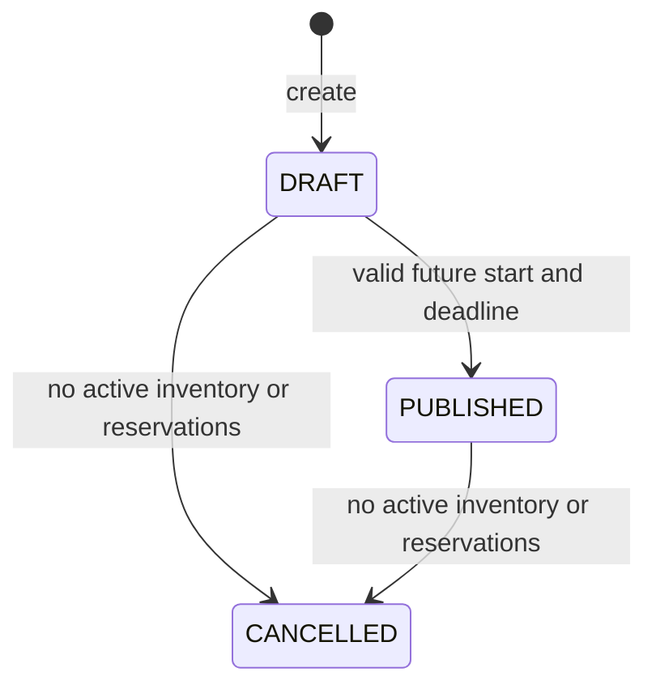

# Organizer event management

Task 05 implements a private organizer API. Task 06 connects the organizer
dashboard, event forms, list/detail pages, and confirmed lifecycle actions.
Task 07 adds separate [public discovery](discovery.md) endpoints and pages.
Reservation allocation/expiration (08), payments, and ticketing remain future work.
There is no hard-delete endpoint. Public visibility never changes private ownership.

## Access and model

All endpoints are under `/api/organizer/events`. They reuse `requireDatabase`,
`requireAuth(config)`, `requireRole('ORGANIZER')`, and the existing trusted-Origin
defense for mutations. Identity comes from the authenticated persisted user,
never a client-supplied organizer ID. Every resource lookup and conditional write
includes both event ID and organizer ID. Missing and unowned events both return
404 `EVENT_NOT_FOUND`. Attendees receive 403; missing/invalid/revoked sessions
receive 401. Invalid signing configuration or unavailable MongoDB fails with 503.
All organizer event responses use `Cache-Control: no-store`.

The existing Event fields are retained: organizer reference, title, description,
venue, start/end/deadline, capacity, integer price in paise, status, reserved
count, and timestamps. Existing event indexes are preserved; Task 07 adds public
schedule/price indexes documented in discovery.md. The additive
`reservation_event_status` index (`eventId: 1, status: 1`) supports cancellation's
defensive active-booking lookup. Startup creates/verifies it without dropping
existing indexes or introducing reservation TTL deletion.

## Endpoints

| Method/path | Success | Behavior |
| --- | --- | --- |
| `POST /api/organizer/events` | 201 | Create an owned DRAFT with reservedCount 0 |
| `GET /api/organizer/events` | 200 | List only the current organizer's events |
| `GET /api/organizer/events/:id` | 200 | Retrieve an owned event |
| `PATCH /api/organizer/events/:id` | 200 | Validate and edit permitted fields |
| `POST /api/organizer/events/:id/publish` | 200 | Conditionally publish a valid DRAFT |
| `POST /api/organizer/events/:id/cancel` | 200 | Cancel an unoccupied DRAFT/PUBLISHED event transactionally |

Create/PATCH require JSON. Publish/cancel accept no body or an empty JSON object;
any supplied field is rejected. Every unsafe request requires an exact configured
Origin, even when sent with a valid cookie. Browser JavaScript uses relative
`/api` URLs and lets the browser supply Origin/cookies. Read requests need no
Origin header. Authentication is checked before event input/ownership handling.

### Create request

```json
{
  "title": "Cloud Engineering Workshop",
  "description": "A hands-on introduction to cloud infrastructure.",
  "venue": "SST Bengaluru",
  "startAt": "2026-11-10T10:00:00.000Z",
  "endAt": "2026-11-10T13:00:00.000Z",
  "registrationDeadline": "2026-11-09T18:00:00.000Z",
  "capacity": 100,
  "pricePaise": 19900
}
```

Choose future dates when trying this example after its stated date. `19900`
paise represents INR 199.00. Zero is a valid free-event price; decimal rupee
amounts, numeric strings, fractions, negative values, and unsafe integers are
not valid price inputs.

### Event response

All single-event operations use `{ success: true, data: { event } }`. An explicit
mapper returns only these fields; no `_id`, `__v`, populated user, or Mongoose
metadata is exposed:

```json
{
  "success": true,
  "data": {
    "event": {
      "id": "507f1f77bcf86cd799439011",
      "organizerId": "507f191e810c19729de860ea",
      "title": "Cloud Engineering Workshop",
      "description": "A hands-on introduction to cloud infrastructure.",
      "venue": "SST Bengaluru",
      "startAt": "2026-11-10T10:00:00.000Z",
      "endAt": "2026-11-10T13:00:00.000Z",
      "registrationDeadline": "2026-11-09T18:00:00.000Z",
      "capacity": 100,
      "pricePaise": 19900,
      "reservedCount": 0,
      "status": "DRAFT",
      "createdAt": "2026-10-26T00:00:00.000Z",
      "updatedAt": "2026-10-26T00:00:00.000Z"
    }
  }
}
```

Dates are normalized to UTC ISO strings. Inventory metadata is the persisted
capacity/reserved count, not fabricated availability or reservation statistics.

## Validation and editing

| Field | API constraint |
| --- | --- |
| title | Trimmed string, 3–120 UTF-16 code units |
| description | Optional at creation (defaults to empty), trimmed, at most 10,000 code units |
| venue | Required trimmed string, 1–200 code units |
| startAt/endAt/registrationDeadline | Valid ISO date-time with `Z` or explicit `±HH:MM` offset; calendar validation |
| capacity | Positive integer, at most 1,000,000 |
| pricePaise | Nonnegative safe integer, at most Number.MAX_SAFE_INTEGER |
| route id | Exactly 24 hexadecimal ObjectId characters |

End must be strictly after start, and deadline must not exceed start. New events
must start in the future. Draft edits validate the complete merged state and
require a future start; reschedule an elapsed draft before editing it. A draft
may have an elapsed registration deadline while being prepared, but cannot be
published until the deadline is corrected to a future time.

PATCH requires at least one field. DRAFT permits all eight creation fields.
PUBLISHED permits only title, description, and venue, including after its start;
dates, capacity, price, and deadline are frozen, even if the submitted value is
unchanged. CANCELLED cannot be edited or reopened. Example:

```json
{ "title": "Updated workshop title", "venue": "Room B" }
```

All bodies use strict Zod schemas. `_id`, organizerId, reservedCount, status,
timestamps, `__v`, MongoDB operators, and all other unknown fields are rejected.
The service validates merged state and runs document validation before its
allowlisted conditional update. Capacity cannot fall below occupied inventory.
Event management never overwrites or increments/decrements reservedCount.

## Listing

Example: `GET /api/organizer/events?status=DRAFT&page=1&limit=10&sort=newest&search=Cloud`

| Query | Behavior |
| --- | --- |
| page | Default 1; positive decimal integer, maximum 10,000 |
| limit | Default 10; positive decimal integer, maximum 50 |
| status | Optional DRAFT/PUBLISHED/CANCELLED |
| sort | newest (default) or oldest, by createdAt and then ObjectId in the same direction |
| search | Optional trimmed literal title substring, case insensitive, maximum 120 code units; empty ignored |

Malformed, repeated, or unknown parameters are rejected. Regex metacharacters in
search are escaped; clients cannot supply executable regex patterns/operators.
One organizer-filtered aggregation feeds both the page and total count, with
bounded page output and a 2-second server query budget. Large datasets may need
future cursor pagination/search indexing; no full-text infrastructure is added.
A query timeout is a 503 error, never a successful empty page.

```json
{
  "success": true,
  "data": {
    "events": [],
    "pagination": { "page": 1, "limit": 10, "total": 0, "totalPages": 0 }
  }
}
```

`total` counts all owned matches before pagination. Empty collections have zero
totalPages. A valid page beyond the last page returns an empty events array and
the actual total/totalPages. Count/page share the aggregation input; later
requests can reflect intervening changes.

## Lifecycle and concurrency



Publication revalidates all required fields and date relationships. Both start
and deadline must be strictly in the future; the atomic write also checks these
time boundaries. Repeated publication and repeated cancellation return 409
`INVALID_EVENT_STATE`, rather than an idempotent success. Cancelled records are
retained permanently by this API.

Edits and transitions compare the loaded internal version, current status,
organizer, and reserved count in an atomic `findOneAndUpdate`. Each successful
management mutation increments `__v` explicitly; query updates do not inherit
document-save optimistic concurrency automatically. A lost comparison returns
409 `EVENT_UPDATE_CONFLICT`. No new version parameter is required/exposed.
Task 06 should reload on this conflict and let the organizer review fresh data.
This protects overlapping server operations; it does not detect an old browser
form submitted after another request has already completed before its read.

Cancellation reads the owned event and checks HELD/CONFIRMED reservation records
inside a snapshot transaction, then conditionally writes CANCELLED. It requires
reservedCount exactly zero, and also blocks active documents when a counter is
inconsistent. Even a past-deadline HELD record remains active until Task 08
explicitly expires/releases it. EXPIRED/CANCELLED history is retained and does
not block cancellation. No refunds or automatic booking cancellation are implied.

The cancellation transaction uses primary reads and majority commits. MongoDB's
transaction retry re-reads state and rechecks safety after write conflicts. Two
overlapping actions may both succeed when they serialize legally (for example,
publish followed by cancellation); they cannot restore an older state.

Task 08 must allocate inventory and insert a reservation in one transaction,
conditionally updating this same event only while PUBLISHED/open with capacity.
That shared event write serializes allocation against cancellation: the losing
transaction retries its safety checks. Inserting reservations without that event
write, or raw out-of-band database edits, bypasses this application contract and
is unsupported. Cancellation never repairs mismatched inventory automatically.

References: [MongoDB atomic updates](https://www.mongodb.com/docs/manual/core/write-operations-atomicity/),
[transaction write conflicts](https://www.mongodb.com/docs/v8.0/core/transactions-production-consideration/),
[Mongoose versioning](https://mongoosejs.com/docs/guide.html#versionKey), and
[query validation limits](https://mongoosejs.com/docs/validation.html#update-validators).

## Error contract

Errors reuse `{ success: false, error: { code, message, requestId, details? } }`.
Field details contain paths/messages, never submitted values. Database internals,
credential-bearing errors, stack traces, and other users' records are not returned.

| HTTP/code | Meaning |
| --- | --- |
| 400 INVALID_EVENT_INPUT | Invalid body/query/id/merged event, unknown fields, content type |
| 400 INVALID_JSON / 413 PAYLOAD_TOO_LARGE | Existing global JSON parser rules (32 KB request limit) |
| 401 UNAUTHENTICATED | Missing, invalid, expired, revoked session |
| 403 FORBIDDEN / UNTRUSTED_ORIGIN | Wrong persisted role / rejected mutation Origin |
| 404 EVENT_NOT_FOUND | Missing or unowned event |
| 409 INVALID_EVENT_STATE | Forbidden edit or lifecycle transition |
| 409 EVENT_NOT_PUBLISHABLE | Invalid/elapsed draft at publication |
| 409 EVENT_HAS_ACTIVE_RESERVATIONS | Occupied counter or HELD/CONFIRMED records |
| 409 EVENT_UPDATE_CONFLICT | Concurrent version/status/inventory conflict |
| 503 EVENT_QUERY_TIMEOUT | Listing exceeded its server query budget |
| 503 DATABASE_UNAVAILABLE / AUTH_UNAVAILABLE | Required infrastructure unavailable |
| 500 INTERNAL_ERROR | Sanitized unexpected failure; no fake success |

## Verification

`npm run test:events` runs all event integration suites against owned disposable
MongoDB 8.2.6 replica sets with ephemeral JWT keys and controlled dates. Tests use
actual HTTP authentication, persistence, indexes, ownership, lifecycle operations,
and transactional conflicts. Query barriers pause real reads to reproduce races;
fault injection is limited to failure-path checks. They never use/clean an
application or production database. `npm run test:db`, `npm test`, and CI include
the event suites. See the [acceptance record](implementation-plan.md#task-05-acceptance-record).

## Organizer frontend (Task 06)

All event pages compose the existing ProtectedRoute and ORGANIZER RoleGuard.
Unresolved/unavailable authentication hides protected content; guests go to login
and attendees see access denied. Implemented local event paths are allowlisted
as organizer-only login return destinations. Event ownership remains enforced
by the server; a missing or unowned event produces the same safe not-found view.

| Browser route | Responsibility |
| --- | --- |
| `/organizer/dashboard` | Existing account overview plus newest three real events, backend total, and workspace links |
| `/organizer/events` | Owned events, debounced title search, status/sort/page-size filters, previous/next pagination |
| `/organizer/events/new` | Validated draft creation; successful response leads to a fresh event-detail GET |
| `/organizer/events/:id` | Actual persisted details, status, inventory metadata, and permitted lifecycle actions |
| `/organizer/events/:id/edit` | Shared form for draft/descriptive published edits; cancelled events remain read-only |

OrganizerLayout and OrganizerSidebar extend the established dark product shell.
My Events and Create Event are functional on desktop and mobile. Registrations,
check-in, and analytics remain clearly labeled future modules. Dashboard recent
events use a bounded `limit=3` request; total comes from pagination metadata.
No draft/published counts, revenue, or attendance statistics are invented.

### Form, currency, and local time

One EventForm handles creation and editing with the same title/venue/description,
capacity, and date bounds as the backend. Drafts need a future start, end after
start, and deadline no later than start. An elapsed registration deadline may
be saved as a draft, but publication requires a future deadline. Published forms
lock schedule, deadline, capacity, and price. PATCH sends only permitted changed
fields; unchanged forms make no request. Cancelled edit URLs show read-only
feedback with no form. Failed requests preserve input, associate inline errors,
and expose safe feedback and request references.

Ticket prices are entered in rupees without the currency symbol. Decimal text is
validated to at most two fractional places and converted with BigInt arithmetic
before conversion to a safe integer number of paise. `199.00` becomes 19900;
`0.00` is free. Negative amounts, exponent notation, excessive precision, and
values beyond Number.MAX_SAFE_INTEGER paise are rejected. Display groups rupees
using `en-IN` and formats the final two paise digits exactly, including at the
safe-integer bound; binary floating-point multiplication is not used.

Date inputs represent the browser's local wall-clock time. The form names the
resolved local timezone, and detail/list displays use `en-IN` dates. Calendar
components are interpreted locally and converted to UTC ISO strings. UTC `Z`
is never appended directly to a local wall time. Component round trips reject
invalid dates and nonexistent local times; existing seconds/milliseconds survive
editing. Ambiguous daylight-saving times use the browser Date implementation's
choice; there is no separate timezone selector. See
[local date-time inputs](https://developer.mozilla.org/en-US/docs/Web/HTML/Reference/Elements/input/datetime-local)
and [Date timezone behavior](https://developer.mozilla.org/en-US/docs/Web/JavaScript/Reference/Global_Objects/Date).

### API and request consistency

The existing HTTP client now supports PATCH alongside GET/POST. The typed event
service uses only the six Task 05 endpoints, same-origin cookies, relative `/api`
paths, cancellation, and existing request timeouts. Runtime parsers check public
event shape, dates, safe inventory/prices, status, and pagination consistency.
Only allowlisted input fields are serialized. JWTs/cookies are never read or
written by frontend code; no event or credential data is kept in browser storage.

Focused hooks keep state local and key reads by verified organizer identity,
resource/query, and refresh attempt. Superseded/unmounted requests are aborted
and obsolete results ignored. Query changes hide old results until a fresh
response; failures never become empty-list success. Logout unmounts protected
pages, and identity changes immediately hide previous organizer data. Unexpected
owner IDs in responses are rejected. HTTP 401 or role-forbidden responses trigger
existing `/me` revalidation; 503/network errors remain recoverable service errors.

List filters live in the URL and survive page navigation/back. Search waits
350 ms after input, uses the backend's literal title-search contract, and resets
page one. Status, sort, and page size changes also reset pagination. A pending
search is applied at page one even when pagination is clicked before debounce
finishes. API pagination totals determine navigation; empty out-of-range pages
offer a first-page action. Limits remain within the backend's 1–50 / page 10,000 bounds.

### Confirmed lifecycle actions and recovery

Draft publication opens a modal explaining upcoming-event public visibility and
the economic/schedule fields that become locked. Cancellation opens a separate
modal explaining permanence, record retention, active-reservation restrictions,
and the absence of refunds. Both require explicit confirmation. The dialogs
label their purpose, focus the least destructive control, trap Tab, support
Escape when idle, make the background inert, and restore focus on close.

Pending actions disable repeat submission. Status changes and success feedback
follow actual successful responses; details are fetched again after mutations.
The publication page and open confirmation also update at start/deadline time
boundaries. An elapsed window disables publication and prompts schedule correction.
Known expired publication deadlines or occupied counters disable corresponding
actions, while the backend remains authoritative. Active-reservation conflicts
show the actual policy without implying cancellation or refunds. On 409, form/
dialog submission is blocked until the organizer reloads/reviews current state.
Reload explicitly replaces unsaved form edits; it never silently resubmits them.

Safe local messages distinguish validation, not-found, access, lifecycle,
concurrency, rate limits, unavailable service, network, and timeout failures.
Allowlisted server validation paths identify fields; raw server error messages
or stacks are not rendered. No automatic mutation retries or offline queue exist.
An aborted/timed-out request may already have committed on the server, so users
are told to check/reload events before repeating a change. The Task 05 limitation
on old browser forms without a client revision/ETag contract still applies.

`npm run test:web` runs the complete frontend suite, including HTTP-boundary,
currency/date, form, routing, lifecycle/dialog, pagination, and identity-isolation
tests. `npm run test:watch -w client` watches them. Root `npm test`, `npm run check`,
and CI also run unchanged backend regressions. Real-browser verification uses
disposable accounts and an owned replica set; see the
[Task 06 acceptance record](implementation-plan.md#task-06-acceptance-record).
