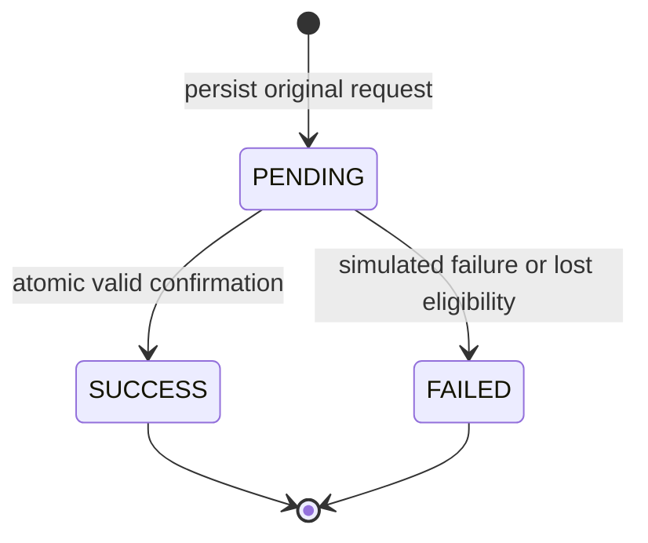

# Simulated payments — Task 09

**No real money is collected.** This deterministic academic checkout stores real
MongoDB records and confirms real reservations, while attendees deliberately choose
SUCCESS or FAILURE as a simulation scenario. There is no external payment provider,
bank interface, card/UPI data, webhook, real charge, or financial credential.

## State and invariants



Terminal attempts never change state. Replaying a result is a read, not a new
payment. Failed attempts remain in history; a deliberate retry uses a new key.
Failure leaves a valid reservation HELD and does not release its unit. Task 08
continues to own HELD → EXPIRED/CANCELLED and exactly-once capacity release.

Task 09 owns HELD → CONFIRMED. A successful attempt and its corresponding
confirmation must commit together. Exactly one attempt can win that transition.
`Event.reservedCount` remains equal to HELD + CONFIRMED records: confirmation
retains the original unit, immutable reservation price, and original expiry.
It does not allocate again, extend a deadline, issue a ticket, or release capacity.

## Model and indexes

PaymentAttempt retains reservationId, transactionId, idempotencyKey, amountPaise,
status, failureReason, createdAt and updatedAt. Task 09 adds:

- `simulationOutcome`: immutable SUCCESS/FAILURE request binding, always set by
  this service. Optional in the model solely to keep pre-existing records readable.
- `completedAt`: server terminal-transition time; optional for legacy records.

Existing unique transactionId and unique (reservationId, idempotencyKey) indexes
remain, along with the original reservation-history index. An additive
`payment_reservation_history_stable` index includes reservationId/createdAt/_id
for deterministic newest-first history. Startup verifies these indexes before
readiness, without dropping or synchronizing live indexes.

No partial-success index is needed for correctness: every successful transaction
must conditionally win the same HELD reservation transition. A losing transaction
rolls back its tentative success. Integration tests verify this against MongoDB.

## API

All routes require readiness, the existing verified HTTP-only session, persisted
ATTENDEE role, and ownership of the parent reservation. POST additionally requires
an exact trusted Origin. Resource lookups include the owned parent; missing,
malformed or unowned resources return safe 404s. Responses are no-store.

| Method / path | Input | Result |
| --- | --- | --- |
| POST /api/reservations/:id/payments | UUID v4 `Idempotency-Key`; strict JSON `{ "simulationOutcome": "SUCCESS" }` or FAILURE | 200 durable processed/replayed result |
| GET /api/reservations/:id/payments | page default 1/max 10000; limit default 10/max 50; optional exact UUID idempotencyKey | Owned paginated attempts/current reservation |
| GET /api/reservations/:id/payments/:paymentId | Owned parent and attempt IDs | One attempt/current reservation |

POST always uses 200 for a successfully processed domain result, including a
simulated FAILED outcome. A transport/database error is not a simulated decline.
New checkout against EXPIRED/CANCELLED/CONFIRMED is rejected with 409 and creates
no attempt. An existing PENDING request can still be resumed after eligibility is
lost: it becomes FAILED with a safe reason and returns its durable result with 200.

Keys must be unpredictable UUID v4 identifiers. Validation rejects missing,
overlong, repeated/comma-joined or invalid keys and normalizes their case. Bodies
accept only simulationOutcome; amount, transactionId, userId, reservation status,
confirmedAt, financial fields, operators and unknown fields are rejected. History
queries are strict, bounded and deterministically sorted by createdAt/_id descending.
One snapshot/aggregation supplies both page and count.

Single data is `{ payment, reservation, serverNow }`. List data is
`{ payments, pagination: { page, limit, total, totalPages }, reservation, serverNow }`.
Reservation uses the existing explicit attendee DTO. The payment DTO contains:

```text
id, reservationId, transactionId, idempotencyKey, amountPaise, status,
simulated: true, simulationOutcome, failureReason,
createdAt, updatedAt, completedAt
```

Outcome/key are returned only to the owner so a PENDING attempt can be resumed
after refresh. They are not authentication credentials and never replace session/
ownership checks. Dates are ISO instants; money is exact safe integer paise. Raw
Mongoose objects, account identities, session data, and internal errors are excluded.
Unknown legacy failure strings become UNKNOWN_FAILURE, never raw diagnostics.

| HTTP / code | Meaning |
| --- | --- |
| 400 PAYMENT_INVALID_INPUT | Invalid body, content type, key or history query |
| 401 UNAUTHENTICATED | Missing/expired/revoked session or missing account |
| 403 FORBIDDEN / UNTRUSTED_ORIGIN | Wrong current role / unsafe Origin |
| 404 RESERVATION_NOT_FOUND / PAYMENT_ATTEMPT_NOT_FOUND | Missing, malformed or unowned resource |
| 409 PAYMENT_IDEMPOTENCY_CONFLICT | Key reused with different or unknown legacy request parameters |
| 409 RESERVATION_EXPIRED / RESERVATION_NOT_PAYABLE / RESERVATION_ALREADY_CONFIRMED | A new checkout is ineligible |
| 409 PAYMENT_CONFIRMATION_CONFLICT | A boundary changed repeatedly; check status before same-key recovery |
| 429 RATE_LIMITED | More than 60 POSTs per minute per verified attendee per process |
| 503 DATABASE_UNAVAILABLE / AUTH_UNAVAILABLE | Required infrastructure unavailable |
| 503 PAYMENT_OUTCOME_UNKNOWN | Commit outcome unresolved; check/resume the same request |
| 503 PAYMENT_INCONSISTENT / INVENTORY_INCONSISTENT | Persisted state fails an invariant; investigation required |

Errors use the normal safe request-ID envelope. Fixed operation/invariant logs
omit exception messages, keys, credentials and submitted values. The in-memory
POST limiter counts replays too; read-only recovery remains available. It resets
on restart and is not a distributed limiter or substitute for deployment controls.

## Two durable stages and idempotency

Both stages use the existing connection and Task 08 session/transaction primitive,
with snapshot reads, primary routing, majority writes, an 8-second driver deadline
per transaction and 2-second commit maximum. Labelled transient/commit retries are
bounded by that deadline. No parallel session operations or external effects occur
inside callbacks. A clock-boundary abort permits at most one additional fresh
evaluation. There is no recursive retry or blind duplicate-insert loop.

1. Preparation validates the current attendee and owned reservation. Existing
   key/request binding is checked first, even after terminal reservation states.
   A new eligible request touches the HELD reservation conditionally and persists
   PENDING, a backend `sim_<UUID>` transaction reference, the stored reservation
   amount, and the immutable requested outcome. That stage commits independently.
2. Finalization reads the owned attempt and reservation again. Terminal attempts
   replay unchanged. PENDING is resolved from its stored outcome, not fresh client
   instructions. Valid success changes the attempt and reservation in one transaction.

```mermaid
sequenceDiagram
  participant A as Attendee
  participant API as Payment service
  participant DB as MongoDB replica set
  A->>API: POST outcome + original UUID key
  API->>DB: Transaction 1: verify owner, key, eligible hold
  API->>DB: Commit PENDING + price/request binding
  Note over API,DB: Interruption here leaves a resumable attempt
  API->>DB: Transaction 2: reread attempt, reservation, event, inventory
  alt Valid stored SUCCESS scenario
    API->>DB: Conditional event version write (counter unchanged)
    API->>DB: Tentative PENDING to SUCCESS
    API->>DB: Conditional unexpired HELD to CONFIRMED
    API->>DB: Commit both final states
  else Failure scenario or eligibility lost
    API->>DB: Persist FAILED; reconcile due expiry when necessary
    API->>DB: Commit safe current reservation state
  end
  API-->>A: Durable payment + current reservation
```

The unique reservation/key index protects concurrent preparation. A duplicate-key
loser rolls back and reads the winner, validating its original outcome. It never
inserts another attempt blindly. Same-key terminal replay preserves payment ID,
transaction ID, amount and terminal metadata. The accompanying reservation is its
current snapshot: a historical failed attempt can be replayed after a different
attempt confirmed the booking without changing that failure into success.

A crash/error after preparation leaves PENDING, not a fictional failed payment.
Check exact-key history when the payment ID was never received; use individual
GET when known. Explicitly repeat POST with the same key/outcome to resume. There
is no external provider and deterministic stored-outcome replay is safe. Different
keys racing one reservation may produce one SUCCESS, FAILED competitors already
prepared, and 409s for requests that see an already-confirmed reservation.

Failed attempts remain immutable. A deliberate retry is a new request with a new
key and the same trusted reservation price. Free reservations use this identical
service with amount 0; they are not automatically confirmed when held.

## Confirmation, expiry and cancellation

Confirmation requires PENDING, matching snapshot amount, owned HELD, a future hold
deadline and a published event whose start remains future. Registration deadline
is an admission rule for new holds; an existing valid hold may complete checkout
after admission closes, provided the event has not started and the hold is unexpired.

The service checks inventory in the same snapshot, writes the Event's version
conditionally without changing its counter, tentatively updates the payment,
then rereads server time immediately before the reservation transition. Both
Event/Reservation predicates additionally compare their deadlines with MongoDB
`$$NOW` at the actual write. Crossing a boundary aborts the tentative success and
re-evaluates from fresh state. Production application/database clocks still need
synchronization; these checks do not authorize client-controlled timestamps.

Task 08 expiry/cancellation and payment confirmation write the same reservation;
MongoDB conflicts force fresh safety checks. If confirmation wins while valid,
later cleanup leaves its unit allocated. If expiry wins, payment cannot succeed
and its pending attempt fails RESERVATION_EXPIRED. Cancellation behaves similarly.
Expired HELD reconciliation uses Task 08's exactly-once release in the payment
transaction. Cancelled/confirmed reservations are never reopened or reallocated.
No automatic inventory repair or confirmed-booking refunds are implemented.

## Frontend and recovery

Owned reservation details retain their countdown and add clearly labelled outcome
radios, exact cost, pending/uncertain feedback, result and paginated payment history.
Success appears only from a durable API result and a fresh reservation read. It
shows the simulated transaction reference, amount and available completion time.
Digital ticket generation remains explicitly the next milestone. Free checkout
uses **Confirm Free Reservation**. Expired/cancelled/confirmed records offer no new
checkout; an existing pending request may be resolved safely to its terminal result.

The shared mutation mutex prevents duplicate payment/cancel submissions. A key is
generated once before sending and is retained by a small memory-only recovery
provider across route navigation. Timeouts/network/503/malformed replies remain
uncertain, never simulated failure. Check payment status reads the original attempt;
resume sends its same key/outcome. Only an actual FAILED result allows a fresh
logical retry. Controls wait for history loading so a persisted PENDING attempt
can be recovered after a hard refresh instead of silently replacing it.

Reads reuse attendee-scoped abort/generation handling. Logout/account changes clear
keys; unverified sessions hide private state. No payment/identity/key data is written
to browser storage. Hard refresh loses memory-only keys; persisted attempts expose
their owner-only recovery metadata through history. A request not yet visible after
an interrupted response should be checked/resumed with its original in-memory key.
Backend conditional confirmation still prevents multiple successes across devices.

## Verification and limits

`npm run test:payments` runs real HTTP/replica-set tests; normal tests, test:db,
check and CI include them. Tests own unique disposable MongoDB 8.2.6 databases,
ephemeral signing keys and controlled clocks. They never clean application/Atlas
data. Consistent-snapshot assertions compare reservation/payment terminal states
and HELD+CONFIRMED inventory after races and rollback. Frontend tests replace only
HTTP, exercising the actual router, provider, parsers, controls and recovery.
See the [Task 09 acceptance record](implementation-plan.md#task-09-acceptance-record).

There is no durable background payment queue or automatic PENDING finalizer:
the owner checks/resumes new Task 09 requests through the documented APIs. Pre-09
records lacking an original outcome remain readable but cannot safely replay an
unknown request; they return a conflict rather than guessing an authorization.
There is no real provider, webhook verification, charge/refund/dispute handling,
managed production deployment or claim of financial-processing certification.

**Task 10 must issue at most one QR ticket for each genuinely CONFIRMED reservation.**
It must respect the unique Ticket reservation index, verify durable confirmation/
successful-payment evidence, and never mint tickets from client assertions or a
payment timeout. QR issuance, wallets, cryptographic verification, check-in and
analytics are not implemented by Task 09.
