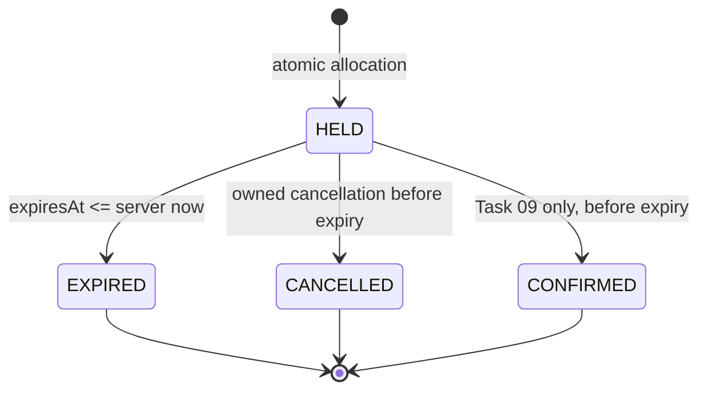
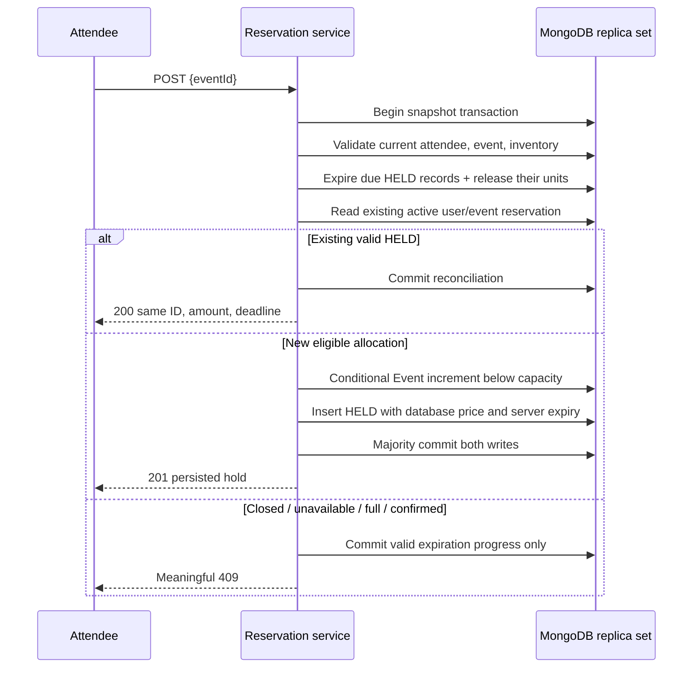

# Reservations — Task 08

Task 09 now adds [simulated checkout, retries and atomic confirmation](payments.md)
to these owned reservation pages. Hold creation, expiry and cancellation keep the
contracts below; every new hold still begins as HELD, including free events.

One reservation holds **one ticket** for **600,000 ms** from server creation.
Every allocation starts as HELD, including free events. Amounts are exact,
nonnegative safe integer paise copied from the Event inside the transaction.
The original amount and deadline are returned on duplicate requests; retrying
does not extend a hold. History is retained, with no reservation TTL or deletion.

## Lifecycle and inventory



`Event.reservedCount === count(HELD + CONFIRMED)` and
`0 <= reservedCount <= capacity`. An elapsed HELD record remains allocated until
a transaction explicitly changes its state. Transition and counter change commit
together. EXPIRED/CANCELLED records occupy no capacity. A new eligible hold may
coexist with older terminal history. A CONFIRMED record keeps its inventory.

Every reservation write checks the event's safe integer bounds and counts active
records in the **same transaction snapshot**. A mismatch fails closed with 503
INVENTORY_INCONSISTENT. There is no automatic counter repair or decrement clamp.
Investigate the fixed operational error/request ID (worker errors also identify
the reservation) and restore consistency through a separately reviewed procedure.
Do not manually delete active records or rewrite counters in a live database.

## API contract

All four endpoints require database readiness, the existing HTTP-only session,
and a current persisted ATTENDEE account. Unsafe requests require an exact trusted
Origin. ORGANIZER accounts receive 403. All private responses use no-store.
Ownership is derived from the session, never request fields. Missing, malformed,
and unowned reservation resource IDs share 404 RESERVATION_NOT_FOUND.

| Method / path | Input | Success |
| --- | --- | --- |
| POST /api/reservations | JSON `{ "eventId": "<24 hex characters>" }` only | 201 new HELD; 200 existing valid HELD |
| GET /api/reservations | page (default 1, max 10000), limit (default 10, max 50), optional status | Owned newest-first history + pagination |
| GET /api/reservations/:id | Owned reservation ID | Current owned reservation, reconciling elapsed hold |
| POST /api/reservations/:id/cancel | Empty body or JSON `{}` | CANCELLED, or current EXPIRED/CANCELLED state |

Unknown, repeated, array/operator query properties and unknown/protected body
fields are rejected. Price, userId, status, expiresAt, reservedCount and quantity
cannot be supplied. Invalid create eventId is 400; missing event is 404. No DELETE,
arbitrary-expiration, payment, confirmation, or ticket endpoint is added here.

Single success responses have `{ success: true, data: { reservation, serverNow } }`.
Creation additionally returns `created: boolean`. The explicit reservation DTO is:

```json
{
  "id": "<reservation id>",
  "eventId": "<event id>",
  "status": "HELD",
  "amountPaise": 24950,
  "createdAt": "<server ISO timestamp>",
  "updatedAt": "<server ISO timestamp>",
  "expiresAt": "<creation + 10 minutes>",
  "event": {
    "id": "<event id>", "title": "Design After Hours", "venue": "Bengaluru",
    "status": "PUBLISHED", "startAt": "<ISO>", "endAt": "<ISO>",
    "registrationDeadline": "<ISO>"
  }
}
```

There is no user/organizer identity, session, password, internal version, payment,
or ticket data in this DTO. Terminal history survives a missing event (`event: null`)
or cancelled event (safe current summary). An orphaned active hold cannot safely
release missing inventory and raises an operational error.

List data is `{ reservations, pagination: { page, limit, total, totalPages }, serverNow }`.
Sorting is createdAt descending then ObjectId descending; page and count share
one aggregation/snapshot. Dates remain ISO instants and prices remain paise.

| Condition | HTTP / stable code |
| --- | --- |
| Invalid body/query | 400 INVALID_RESERVATION_INPUT |
| Missing/revoked/expired session | 401 UNAUTHENTICATED (existing auth contract) |
| Wrong role / untrusted Origin | 403 FORBIDDEN / UNTRUSTED_ORIGIN |
| Missing event / missing or unowned reservation | 404 EVENT_NOT_FOUND / RESERVATION_NOT_FOUND |
| Draft/cancelled/started event | 409 EVENT_NOT_BOOKABLE |
| Elapsed registration deadline | 409 REGISTRATION_CLOSED |
| Capacity full | 409 EVENT_SOLD_OUT |
| Existing CONFIRMED allocation | 409 ALREADY_BOOKED |
| Attempted confirmed cancellation | 409 RESERVATION_CONFIRMED |
| Concurrent state requires review | 409 RESERVATION_CONFLICT |
| Counter mismatch / pending large history cleanup | 503 INVENTORY_INCONSISTENT / RESERVATION_RECONCILIATION_PENDING |
| Database unavailable / unresolved commit | 503 DATABASE_UNAVAILABLE / RESERVATION_OUTCOME_UNKNOWN |

Errors use the existing safe `{ success: false, error: { code, message, requestId } }`
envelope. Infrastructure failures never become sold-out conflicts or empty history.

## Transaction design and retries

All operations use sessions on the existing Mongoose connection. Transactions use
snapshot reads, primary routing, majority writes, an **8-second total driver deadline**
and **2-second maximum commit time**. The installed driver retries labelled transient
transactions and uncertain commits within that deadline. Callbacks contain serial
database operations only, with no external effects, parallel session operations,
recursive retries, or browser-controlled timestamps.

Allocation validates the persisted attendee and Event inside that snapshot,
reconciles a bounded set of elapsed holds, and looks for an active user/event record.
A valid HELD is returned unchanged, even if there is no capacity for a new hold.
CONFIRMED conflicts. Otherwise publication, future start, and open deadline are
checked again before a conditional Event update that includes
`$expr: { $lt: ['$reservedCount', '$capacity'] }`. Only a matching increment permits
inserting the HELD record. Any failed insert aborts the increment. Both must commit
before a new hold is reported as successful.



The active partial unique index is a second database constraint. If a duplicate
active insert loses, its transaction rolls back. One subsequent read transaction
recognizes a still-valid winner (200) or reports a conflict; it never blindly
allocates again. A commit outcome still unknown at the deadline returns 503 and
instructs the attendee to check history. A network timeout is not evidence of an
aborted transaction. Frontend mutations are never automatically retried.

Both allocation and release update the same Event document that organizer
cancellation conditionally writes. Conflicts force a fresh snapshot: either the
allocation wins and cancellation finds active inventory, or cancellation wins and
allocation finds a cancelled event. Organizer descriptive edits also increment
the version; reservation updates never replace descriptive or economic fields.

## Expiration, cancellation, and process lifecycle

Release conditionally matches HELD and `expiresAt <= now` for EXPIRED, or
`expiresAt > now` for CANCELLED. Only modified reservations determine the decrement.
The Event's previous counter must match, and underflow aborts the transaction.
Concurrent workers, repeated cleanup, cancellation, and reads cannot release twice.
Confirmed records are never selected. Cancellation of an elapsed hold returns the
persisted EXPIRED state; repeated cancellation returns the terminal state with 200.

Lazy booking cleanup processes at most **100** due records per event, ordered by
deadline/ID, plus the caller's own elapsed hold if it lies outside that batch
(maximum 101). Large event backlogs make bounded progress; later requests/worker
batches finish them. Public discovery GETs remain read-only availability snapshots.

Owned details reconcile that one hold in their transaction. Listing first processes
up to **100** owned due holds, then checks a fresh snapshot before filtering. If more
due records remain, it returns 503 RESERVATION_RECONCILIATION_PENDING after retaining cleanup
progress, rather than returning indefinitely stale HELD data or reading without a bound.

`createExpirationWorker()` creates no import-time timer. `server.ts` starts the
worker after database initialization, performs an initial batch, then runs once
per **60 seconds**. Each batch selects at most **50** due holds and processes them
serially through the same expiration service. One promise prevents overlap within
the instance; conditional transactions protect multiple processes. Unready databases
are skipped, failures use fixed safe diagnostics, and normal no-op cycles are quiet.
Shutdown clears the timer immediately while HTTP requests drain, stops between
candidates, waits for the current operation, then disconnects MongoDB under the
existing ten-second process deadline. The deadline remains a forced-exit fallback
for requests/driver work that do not drain.

The worker is an in-process best-effort scheduler, not a durable queue. Cleanup can
lag by a minute plus batch/backlog/transaction time, and pauses when the process or
database is unavailable. Sustained backlog requires capacity planning/monitoring;
corrupt records require investigation and may delay their batch. Lazy reconciliation
restores eligible capacity independently. No Redis, external cron, or automatic
inventory repair is required or introduced.

## Attendee experience

Public details offer Sign in to Reserve (allowlisted return to that event), Reserve
Ticket for verified attendees, or an organizer restriction. Closed/sold-out controls
are disabled with explicit availability refresh. POST completion navigates to actual
owned details; no optimistic inventory decrement or paid/confirmed success appears.

`/attendee/reservations` offers actual history, status filtering, newest-first server
pagination, loading/empty/error/retry states. `/attendee/reservations/:id` shows the
reference, event summary, exact amount, timestamps, status and live countdown.
HELD is Awaiting Payment; other labels are Confirmed, Hold Expired, and Cancelled.
The dashboard links to My Reservations; My Tickets remains Task 10.

The countdown uses serverNow/expiry and a memory-only receipt timestamp to account
for device clock offset. It is informational: at zero cancellation becomes disabled
and the page reloads the server state, showing EXPIRED only after confirmation.
Timers/listeners clean up; returning to the tab updates the clock. Accessible
cancellation confirmation shares the existing focus trap, background inertness,
Escape dismissal, pending lock and focus restoration. Successful cancellation
refetches details; failed/uncertain actions preserve a recovery path.

Reads are keyed by verified attendee and resource/query, with abort/generation
protection. Logout, identity changes and session uncertainty hide old private data.
401/role failures revalidate the session; database 503 does not impersonate logout.
There is no browser-storage identity/reservation cache or automatic POST retry.

## Verification and Task 09 contract

The confirmation requirements below are now enforced by the implemented
[Task 09 payment service](payments.md). Simulation, result/history and same-key
recovery replace the old next-milestone checkout placeholder. Ticket issuance
remains Task 10.

`npm run test:reservations` runs real HTTP/replica-set tests; `test:db`, `npm test`,
`npm run check`, and CI include them. Tests own a disposable MongoDB 8.2.6 replica
set, ephemeral signing keys and `.test` accounts; they ignore application MONGODB_URI
and guard cleanup. A consistent-snapshot assertion compares counters and active
records after allocation, rejection, rollback, release, and races.

The [Task 08 acceptance record](implementation-plan.md#task-08-acceptance-record)
records measured races, test counts, compiled-worker and browser evidence.

Task 09 must conditionally require HELD, **expiresAt > server now**, and successful
simulated payment in its confirmation transaction. Confirmation retains the existing
unit, amount and original deadline; it does not increment inventory again. It must
race safely with these transitions and use durable idempotency/payment attempt
rules. A delayed worker cannot make an elapsed hold eligible. Free holds follow
the same contract through explicit zero-value simulated checkout. Task 08 creates no payment
attempts, confirmations, tickets, QR codes, refunds, check-ins, or analytics.
