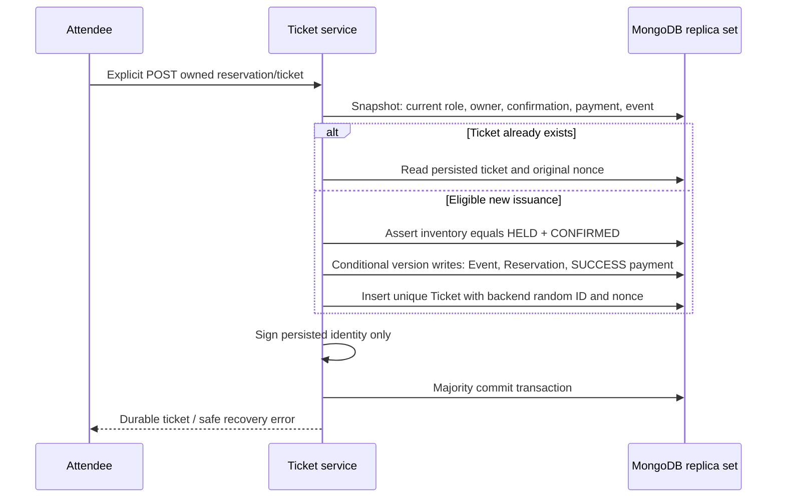
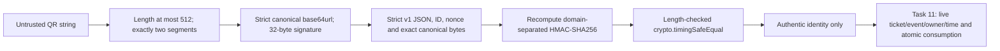

# Secure digital tickets — Task 10

Tickets are durable MongoDB records, issued explicitly after simulated payment
confirmation. No real money is collected. Issuance is a separate recoverable
operation: a failed ticket request never reverses CONFIRMED or SUCCESS.

## Configuration

Generate a **new independent** server-only `TICKET_HMAC_SECRET`:

```sh
node -e "process.stdout.write(require('node:crypto').randomBytes(48).toString('base64url'))"
```

Put it in the ignored local `.env` or deployment secret manager. Generate JWT_SECRET
separately. Never use a VITE_* variable, commit a real value, or log either secret.
Validation requires canonical unpadded base64url encoding of at least 32 bytes,
rejects obvious placeholders/low-diversity values, and rejects decoded equality
with JWT_SECRET. Format checks cannot prove entropy; use the CSPRNG command above.
There is no default/fallback key. Invalid configuration makes ticket APIs return
503; health, public discovery, reservations and payments remain independent.

Keep the same signing key across application instances and restarts. Rotation
invalidates previously exported signatures. A subsequent owned detail read signs
the same persisted ID/nonce with the new key; it does not create another ticket.
This milestone has no key ring or grace period for old exports.

## HTTP contract

All APIs require database readiness, the existing verified session, the current
persisted ATTENDEE role and ownership. POST additionally requires an exact trusted
Origin. All responses are `Cache-Control: no-store`. Malformed/unowned IDs share
safe 404s. JSON errors use the existing request-ID envelope and safe fixed messages.

| Method / path | Input | Result |
| --- | --- | --- |
| POST /api/reservations/:id/ticket | No body or strict JSON `{}` | 201 new ticket; 200 existing ticket |
| GET /api/tickets | page default 1/max 10000; limit default 10/max 50; optional ISSUED/USED/REVOKED status, exact reservationId | Owned stable newest-first summaries and pagination |
| GET /api/tickets/:id | Owned ticket ID | Details; active signed QR or null |

Bodies reject user, amount, status, nonce and every other unknown field. Queries
reject unknown/repeated/operator parameters. Wallet queries start with the owned
reservation set, join the unique ticket association, sort createdAt/_id descending,
and facet page/count in one snapshot. The aggregation has a 2-second server budget;
bounded serial enrichment uses the same 8-second transaction deadline.

Single data is `{ ticket, serverNow }`; issuance also returns `created`. Wallet
data is `{ tickets, pagination: { page, limit, total, totalPages }, serverNow }`.
The explicit summary DTO contains:

```text
id, reservationId, status, createdAt, updatedAt, checkedInAt, amountPaise,
event: null | { id, title, venue, startAt, endAt, status },
admissionState, qrAvailable
```

Only issuance/owned details add `qrPayload`. Wallets omit both full QR credentials
and the raw nonce. There are no account/email/session fields or raw model internals.
The attendee name shown/exported comes from the verified existing session.

`admissionState` is AVAILABLE, USED, REVOKED, EVENT_CANCELLED, EVENT_UNAVAILABLE,
RESERVATION_INVALID or PAYMENT_UNVERIFIED. Historical used/revoked tickets remain
visible with no active QR/export. Missing/cancelled/draft events and invalid payment/
reservation evidence also suppress credentials. Missing parent reservations cannot
prove ownership and return 404. A corrupt active nonce/lifecycle fails closed with
503; lean reads never hydrate a new default nonce. GET never creates/repairs tickets.

Eligibility failures use 409 TICKET_NOT_ELIGIBLE. Configuration failures use 503
TICKET_CONFIGURATION_UNAVAILABLE; unverified infrastructure/state failures use
503 TICKET_UNAVAILABLE. An unresolved commit uses 503 TICKET_ISSUANCE_UNKNOWN.
After uncertainty, read My Tickets or explicitly repeat the same reservation POST.
Do not automatically retry or interpret a transport error as payment failure.

## Exactly-one issuance and inventory

A new ticket requires a CONFIRMED owned reservation, exactly one SUCCESS attempt
with the same immutable safe integer amount, original simulationOutcome SUCCESS,
and a terminal completedAt. Legacy records missing that evidence are not accepted
as proof. The associated event must exist and remain PUBLISHED. Free events require
the same explicit zero-value checkout. No future-start predicate is used: tickets
must be retrievable and issuable on the event day after its start. Time/admission
policy belongs to Task 11; AVAILABLE means this snapshot can display a credential.



Issuance reuses the single connection and reservation transaction primitive:
snapshot reads, primary routing, majority writes, bounded driver retries, 8-second
total deadline and 2-second commit maximum. Session operations are serial. New
issuance conditionally writes all three eligibility sources' versions to prevent
snapshot write skew. Concurrent changes conflict and re-evaluate from fresh state.
Public timestamps, payment terminal metadata, reservation amount/expiry/status and
Event reservedCount are unchanged. Issuance never allocates/releases another unit.

Ticket IDs use a backend random 12-byte ObjectId; nonce uses randomBytes(32).
Existing unique reservationId and qrNonce indexes remain authoritative. A duplicate
reservation insert loser rolls back and reads its eligible winner; it never blindly
reinserts. Unknown commit retry finds the already committed ticket if one exists.
No Ticket TTL is permitted; additive startup rejects an existing Ticket TTL.

```mermaid
stateDiagram-v2
  [*] --> ISSUED: Task 10 explicit verified issuance
  ISSUED --> USED: Task 11 future atomic admission
  ISSUED --> REVOKED: Future authorized revocation workflow
  USED --> [*]: Retain history; no active QR
  REVOKED --> [*]: Retain history; no active QR
```



Task 10 implements only creation and reads. It exposes no check-in, scanner,
revocation, refund, transfer or public verification endpoint. Existing inactive
tickets are never reactivated or replaced by a repeated issuance request.

## Cryptographic wire format

Canonical UTF-8 JSON has exactly these fields in this order:
`{"v":1,"ticketId":"<24 lowercase hex>","nonce":"<43 canonical base64url>"}`.
No PII, mutable event state, secret, JWT, algorithm choice or payment data is embedded.

```text
encoded = base64url(canonical JSON bytes), without padding
mac = HMAC-SHA256(ticket key, ASCII("KairoPass.ticket.v1." + encoded))
QR = encoded + "." + base64url(mac), without padding
```



`verifyTicket(unknown, config)` returns the minimal validated payload or null.
It rejects overlong/non-string input, missing/extra segments, padding, invalid
alphabet/noncanonical trailing bits, malformed/duplicate/unknown JSON fields,
reordered/whitespace-altered serialization, unsupported versions, wrong ID/nonce
formats, wrong-length signatures, tampering and wrong keys. No ordinary string
equality is used for MAC comparison. This server-only helper is reusable by Task 11.

A static signed QR is copyable. A valid signature proves issuer authenticity, not
ownership, current event eligibility, revocation or previous use. Task 11 must read
the actual ticket, compare its persisted nonce, verify organizer/event authority,
revalidate reservation/payment/time policy, and atomically win ISSUED → USED once.
Never trust a displayed status or signature alone as permission to admit someone.

## Attendee experience and export

Protected `/attendee/tickets` and `/:id` use existing AuthProvider, typed relative
HTTP client, role guards and owner/resource-scoped abort/generation handling.
My Tickets is functional in attendee navigation. Confirmed reservation details
read for an existing ticket, then offer explicit Generate Ticket or View Ticket.
No GET-driven issuance, optimistic ticket, payment rollback or automatic POST retry
is present. An in-memory mutation mutex blocks rapid duplicate submissions.

Details use the server payload unchanged with pinned `qrcode` 1.5.4, Q error
correction, a four-module white quiet zone and a 256px black/white SVG QR. There is
no decorative overlay. Rendering failure has a recoverable message. Whole-ticket
1200×2150 PNG export includes branding, event/venue/date/timezone, verified attendee,
amount/status/reference and an isolated 720px QR. Filenames contain only the ticket
ID. Object URLs are revoked; aborted/unmounted exports do not trigger a download.
No QR credentials enter URLs, logs, localStorage/sessionStorage or persistent caches.

SVG display and canvas/Blob/object-URL/download support are required; unsupported
export capabilities show an explicit retryable error. No PDF or print workflow is
claimed. The signing helper stays on the server; the browser only encodes data.

## Verification

Run `npm run test:tickets` for the crypto and owned real MongoDB replica-set suites;
`test:unit` needs no MongoDB; `test:db`, `npm test`, `npm run check` and CI include
ticket integration tests. Frontend tests use the real provider/router/HTTP boundary
and decode the actual QR matrix with jsQR. Tests never use application MONGODB_URI.
See the [Task 10 acceptance record](implementation-plan.md#task-10-acceptance-record)
for measured concurrency, recovery, browser export, quality gate and deployment smoke.
